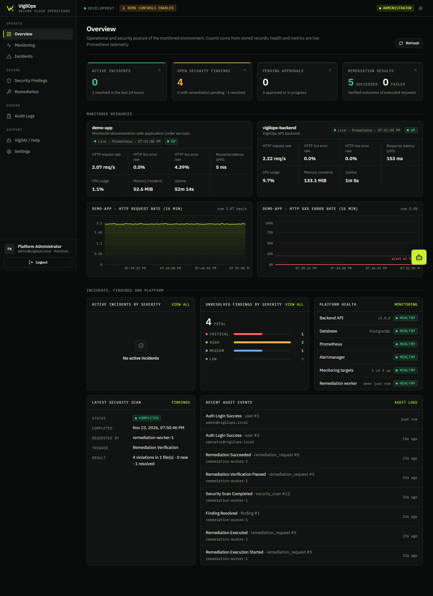
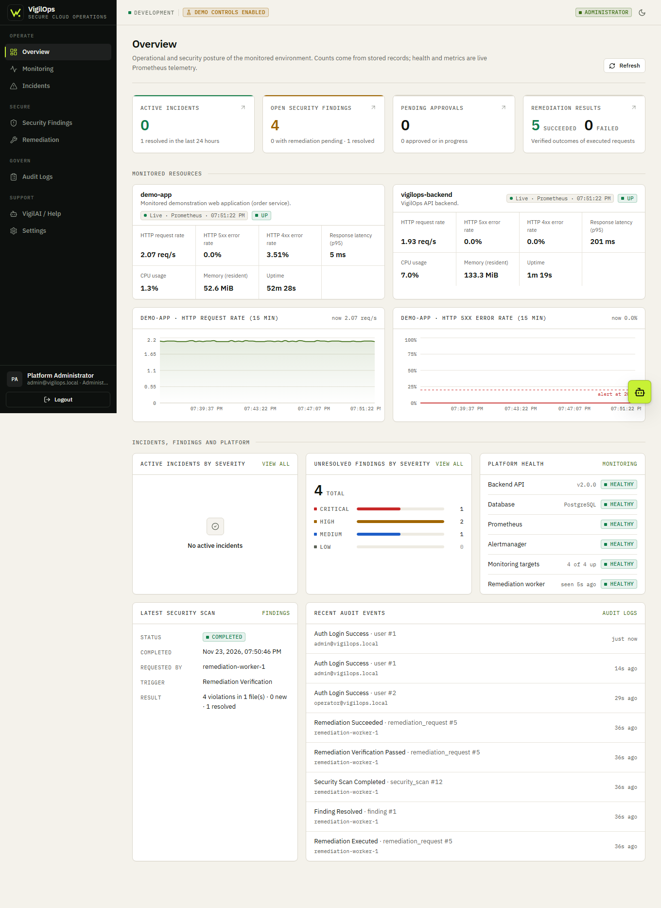
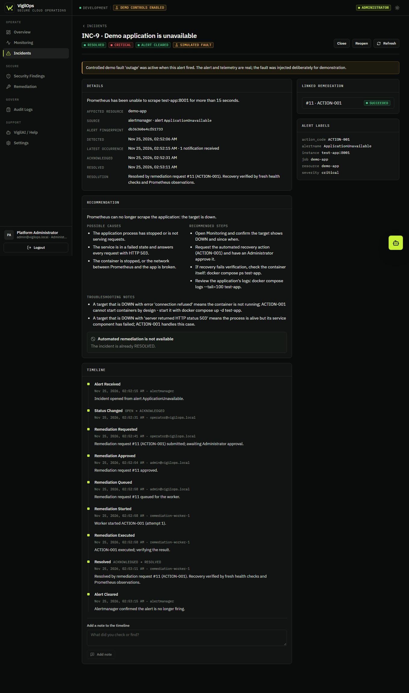
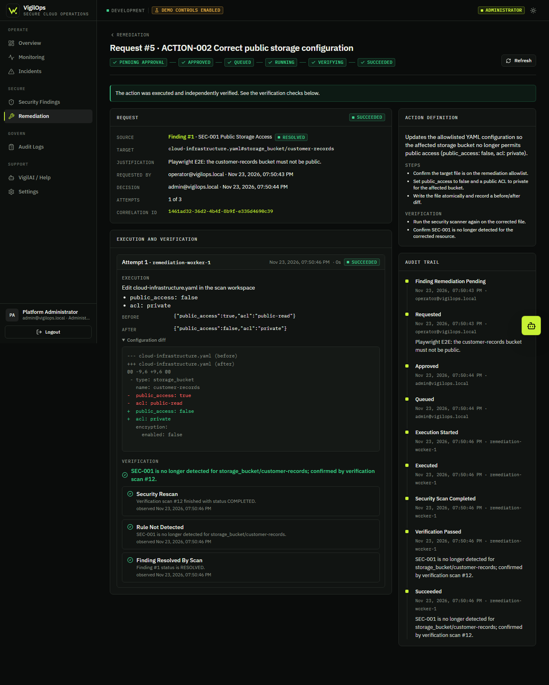
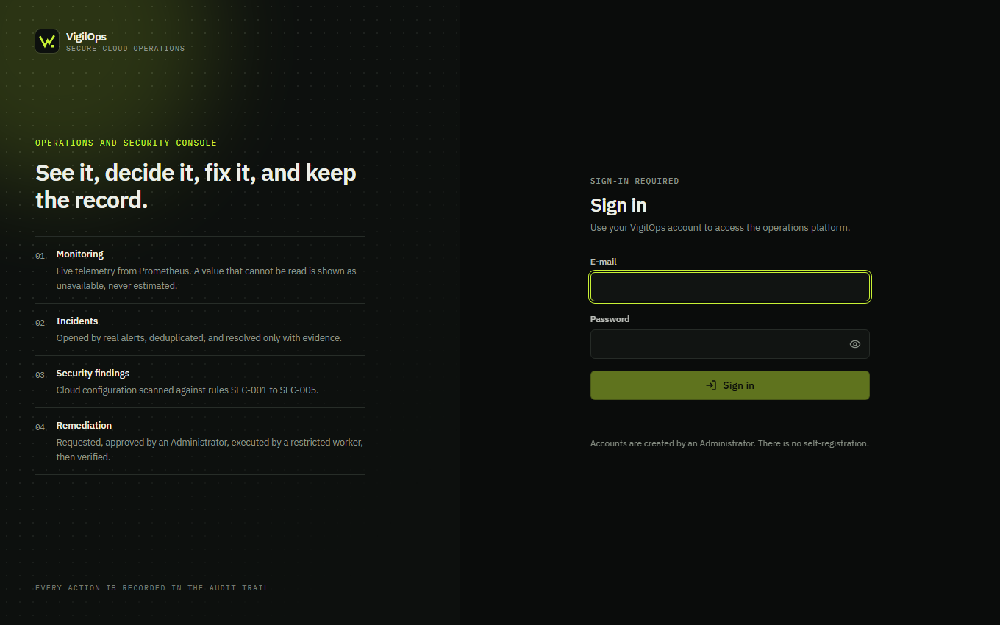
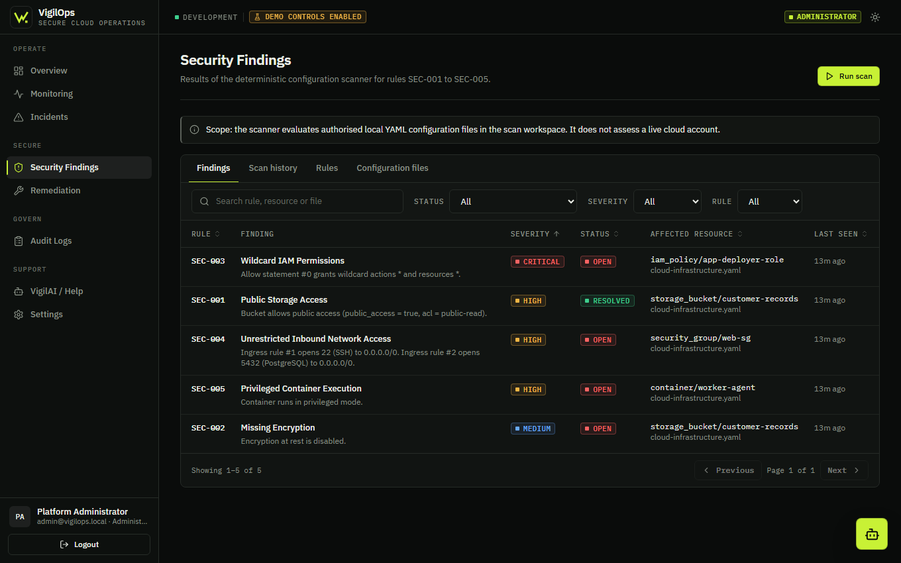
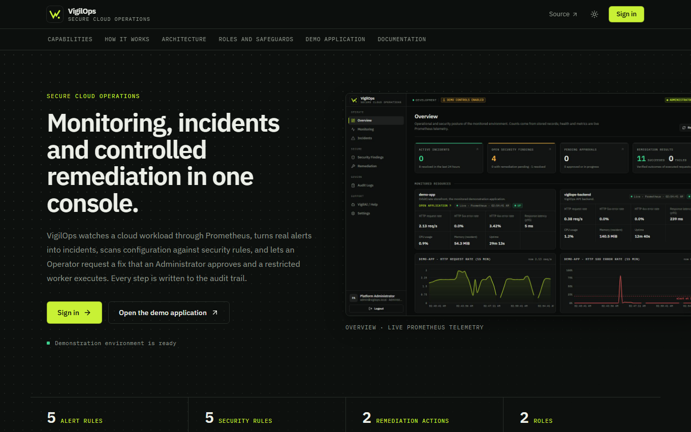
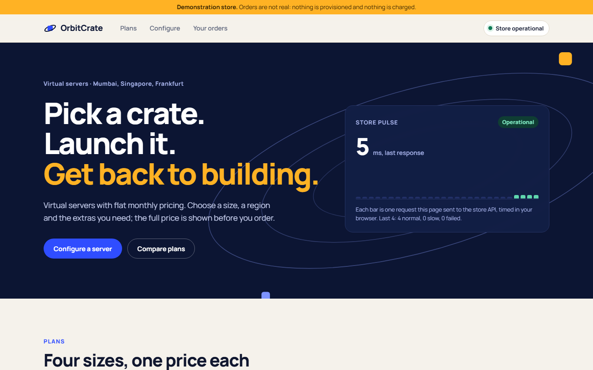
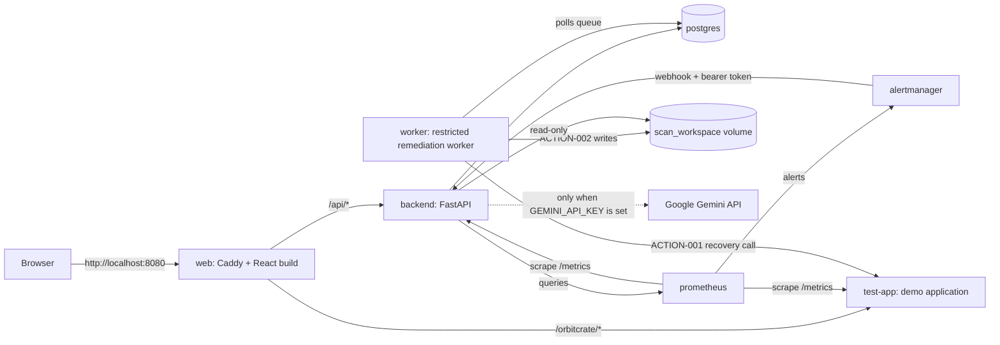

# VigilOps: Secure Cloud Operations

[](https://github.com/Gangadhar017/VigilOps/actions/workflows/ci.yml)

B.Tech CSE (Cloud Computing and Virtualization) major project, built by a team of four students.

## Project introduction

VigilOps is a centralized cloud operations and security management platform that runs as one
Docker Compose stack. A single web application, backed by one API and one PostgreSQL database,
brings together:

- monitoring of a workload with Prometheus and Alertmanager,
- incident management driven by real alerts,
- a deterministic security scanner for YAML cloud-configuration files (rules SEC-001 to SEC-005),
- controlled remediation: a request must be approved by an Administrator and is then executed and
  verified by a restricted worker (ACTION-001 and ACTION-002),
- an append-only audit trail, and
- VigilAI, a read-only assistant backed by Google Gemini, shown as a floating chat widget.

Two pages need no account: a product page at the site root that describes the platform, and
**OrbitCrate** at `/orbitcrate/`, the demonstration storefront whose traffic the platform monitors.

The project was upgraded from an earlier prototype called CloudShield. What the prototype contained
and why parts of it were rewritten is recorded in [docs/phase-0-audit.md](docs/phase-0-audit.md).

## Interface

Screenshots of the running application, taken with `node tests/e2e/screenshots.js` after the
demonstrations had produced real records.

| Overview (dark theme) | Overview (light theme) |
|---|---|
|  |  |

| Incident with its timeline | Remediation request with verification |
|---|---|
|  |  |

| Sign-in | Security findings |
|---|---|
|  |  |

| Product page (public) | OrbitCrate, the monitored demonstration application (public) |
|---|---|
|  |  |

## Problem statement

Operating a cloud workload safely involves several activities that are usually handled by separate
tools: watching telemetry, turning alerts into tracked work, checking configuration for security
mistakes, applying fixes, and proving afterwards who did what. When these are disconnected, alerts are
duplicated or lost, misconfigurations are found late, fixes are applied by hand without review, and
there is no single record linking a problem to its approval, its correction and the evidence that the
correction worked. Fully automatic "self-healing" avoids the manual work but removes human control
over changes.

VigilOps addresses this on a small, local scale: detection is automatic, but every corrective action
needs an explicit approval, is carried out by a component with minimal privileges, is accepted only
after independent verification, and is recorded in an audit trail.

## Objectives

1. Collect real telemetry from a monitored application with Prometheus and show it without
   substituting or inventing values.
2. Convert Alertmanager notifications into incidents with deduplication, a defined lifecycle and a
   timeline.
3. Detect five classes of security misconfiguration in YAML configuration files with deterministic
   rules, and track each finding through a lifecycle.
4. Provide a remediation workflow with separation of duties: request, Administrator approval,
   dispatch, execution by a restricted worker, verification.
5. Enforce role-based access control in the backend for two roles (Administrator, Operator).
6. Record security-relevant and operational events in an append-only audit trail.
7. Offer a read-only assistant that answers questions about the platform only, and keeps working
   (from documentation) when the AI provider is not available.
8. Make the whole system reproducible with one `docker compose` command.

## Features

| Module | What is implemented |
|---|---|
| Overview | Counts of active incidents, open findings, pending approvals and remediation results from stored records; live health and metrics of monitored resources; platform health; latest scan; recent audit events. |
| Monitoring | Availability, request rate, 4xx and 5xx error rate, p95 latency, CPU, memory and uptime for the demo application and the backend, read from Prometheus. Time-series charts (5 min to 6 hours), scrape-target status, active alert rules. Missing values are shown as "Unavailable". |
| Incidents | Created from Alertmanager webhooks (bearer-token protected). One active incident per alert fingerprint; repeated notifications update it. Lifecycle OPEN, ACKNOWLEDGED, IN_PROGRESS, RESOLVED, CLOSED with validated transitions, timeline, comments and built-in runbooks. Resolution requires evidence. |
| Security Findings | Scanner for files in the `vigilops/v1` schema: SEC-001 public storage, SEC-002 missing encryption, SEC-003 wildcard IAM, SEC-004 unrestricted inbound access, SEC-005 privileged container. Scan history, finding states OPEN, REMEDIATION_PENDING, RESOLVED, ACCEPTED_RISK. |
| Remediation | Allowlist of two actions. ACTION-001 recovers the demo application through a token-protected endpoint. ACTION-002 corrects a public storage bucket in an allowlisted file. Statuses from PENDING_APPROVAL to SUCCEEDED or FAILED; success only after verification. |
| Audit Logs | Searchable, filterable event history with actor, outcome and correlation ID. No API edits or deletes audit events; in PostgreSQL a trigger rejects UPDATE and DELETE. |
| VigilAI | Floating chat widget. Backend scope check, knowledge-base retrieval, role-checked read-only live data, optional Gemini generation, output validation. Without an API key it runs in documentation mode. |
| Settings | Profile and password change, user management, three runtime settings, permission matrix, demonstration controls (fault injection, sample configuration reset). |
| Product page | Public page at `/` for visitors who are not signed in (and at `/welcome` for everyone): capabilities, the workflow, the architecture, the two roles, the demonstration application and links to the documentation. It offers sign-in only; accounts are created by an Administrator. |
| OrbitCrate | The monitored demonstration application, public at `/orbitcrate/`: a storefront of a fictional cloud-hosting provider with server plans, a price calculator and orders that move from received to active. Orders are not real. Every request is, and is counted and timed for Prometheus. Its "store pulse" panel shows the response time of each request the page makes, so an injected fault is visible in the store itself. |

## Architecture

Seven long-running containers and one one-shot container on a private Docker network. Only the `web`
service is meant to be reached by users.



The eighth service, `workspace-init`, runs once to give the worker's user ownership of the scan
workspace volume. Details, data flows and design decisions: [docs/architecture.md](docs/architecture.md).

## Technology stack

| Layer | Technology |
|---|---|
| Frontend | React 18, Vite 5, Tailwind CSS 3.4, React Router 6, Axios, Recharts, lucide-react; IBM Plex Sans and Mono bundled with the application (no external font service) |
| Backend | Python 3.11, FastAPI, Pydantic 2, SQLAlchemy 2, Alembic, python-jose (JWT), bcrypt, httpx, PyYAML, prometheus-client |
| Database | PostgreSQL 16 |
| Monitoring | Prometheus v2.51.0, Alertmanager v0.27.0 |
| Reverse proxy | Caddy 2 (serves the frontend build, proxies `/api`) |
| AI | Google Gemini through the official `google-genai` SDK, called only from the backend |
| Packaging | Docker, Docker Compose |
| Tests and CI | pytest, ruff, Vitest with Testing Library, Playwright, GitHub Actions |

## Prerequisites

- Windows 10/11 with Docker Desktop (WSL2 backend), or Ubuntu Linux with Docker Engine and the
  Compose plugin. `compose.prod.yaml` uses the `!reset` and `!override` merge tags, which need a
  recent Docker Compose v2 release.
- Git.
- Optional, only for running tests or scripts outside Docker: Python 3.11, Node.js 20, and a POSIX
  shell (Git Bash or WSL on Windows) for the `.sh` scripts.
- No AWS account, cloud subscription or paid service is required.

Step-by-step installation for Windows and Ubuntu: [docs/setup.md](docs/setup.md).

## Environment setup

All configuration is read from a `.env` file in the repository root. It is never committed.

```text
cp .env.example .env              # Linux, WSL, Git Bash
Copy-Item .env.example .env       # Windows PowerShell
python scripts/generate_env.py    # alternative: write a .env with random secrets
```

`.env.example` contains public placeholder values that let the local development stack start
immediately. They are suitable for local development only. `generate_env.py` refuses to overwrite an
existing `.env` unless `--force` is given; the generated bootstrap account passwords are written to
the file and not printed. Every variable is described in [docs/configuration.md](docs/configuration.md).

## Local execution

```bash
docker compose up --build -d
```

Then open <http://localhost:8080> and sign in with a bootstrap account (see [User roles](#user-roles)).

| Address | What it is |
|---|---|
| <http://localhost:8080> | Web application (port set by `VIGILOPS_HTTP_PORT`) |
| <http://localhost:8000/docs> | Interactive API documentation, development mode only |
| <http://localhost:9090> | Prometheus UI |
| <http://localhost:9093> | Alertmanager UI |

All four ports are bound to `127.0.0.1` by default and are not reachable from other machines. To
open the web application to other devices on a trusted network, set `VIGILOPS_BIND_ADDRESS=0.0.0.0`
in `.env`; the local stack speaks plain HTTP, so do this only on a network you trust.

For frontend development, keep the stack running and start the Vite dev server, which proxies `/api`
to `127.0.0.1:8000`:

```bash
cd frontend
npm install
npm run dev
```

Running the backend outside Docker is possible but needs a database URL and secrets in the
environment; see [docs/setup.md](docs/setup.md#development-without-docker).

## Docker execution

`compose.yaml` defines these services:

| Service | Purpose | Published port |
|---|---|---|
| `postgres` | PostgreSQL 16 database | none |
| `workspace-init` | One-shot: sets ownership of the scan workspace volume, then exits | none |
| `backend` | FastAPI application; applies migrations on start | `127.0.0.1:8000` |
| `worker` | Restricted remediation worker; read-only root filesystem, no capabilities | none |
| `test-app` | Monitored demonstration application with a synthetic load generator | none |
| `prometheus` | Scrapes metrics, evaluates alert rules | `127.0.0.1:9090` |
| `alertmanager` | Groups alerts and calls the backend webhook | `127.0.0.1:9093` |
| `web` | Caddy: serves the React build and proxies `/api` | `127.0.0.1:8080` |

Common commands, run from the repository root:

```bash
docker compose ps                    # status and health of every service
docker compose logs -f backend       # follow one service's logs
docker compose up --build -d         # rebuild and restart after a change
docker compose down                  # stop; data is kept in named volumes
docker compose down -v               # stop and delete all volumes (database, metrics, workspace)
```

Production overlay for a Linux server (publishes only ports 80 and 443, production mode, automatic TLS
through Caddy for the name in `VIGILOPS_DOMAIN`):

```bash
docker compose -f compose.yaml -f compose.prod.yaml up --build -d
```

See [docs/deployment.md](docs/deployment.md). Deployment of the Compose stack to a server of your own
with a public domain was not tested and is documented as unverified.

### Free hosting (Render and Vercel)

For a public demonstration at no cost the repository also contains a second deployment:

- `render.yaml` creates one free Render web service and one free PostgreSQL database. Render's free
  plan has no background workers, private networking or disks, so the API, the worker, the
  demonstration application, Prometheus and Alertmanager run as separate processes and users inside
  one container (`deploy/render/`).
- `frontend/vercel.json` deploys the React application on Vercel and forwards `/api/*` and the store
  below `/orbitcrate/` to Render. The store's own address is answered by a static start page that
  waits while the Render service starts, and `/wake` leads to the Render address itself, which is how
  the pages start a sleeping service.

The free plans have real limits: the backend sleeps after 15 idle minutes and needs about a minute to
wake up (the pages say so and continue by themselves; an uptime monitor can keep it awake), monitoring
history is lost when it does, the `cpu` and `memory` faults are switched off, and
the free database expires after 30 days. Steps, limits and the differences from the Compose stack:
[docs/deployment-render-vercel.md](docs/deployment-render-vercel.md).

[](https://render.com/deploy?repo=https://github.com/Gangadhar017/VigilOps)

## Database setup

No manual step is needed. The `postgres` service creates the database from `POSTGRES_USER`,
`POSTGRES_PASSWORD` and `POSTGRES_DB`. The backend container runs `alembic upgrade head` before it
starts serving, and on first start creates the bootstrap accounts and registers the two monitored
resources. No incidents, findings, metrics or audit history are seeded.

- Data is stored in the named volume `pgdata` and survives `docker compose down`.
- Backup: `sh scripts/backup_db.sh` writes `backups/vigilops-<timestamp>.sql.gz`.
- Restore: `sh scripts/restore_db.sh <file.sql.gz>` (replaces the current database after confirmation).
- Do not change `POSTGRES_PASSWORD` after the volume exists; PostgreSQL only applies it when the
  volume is first initialised. Use only letters, digits, `-` and `_` in it.

Both scripts are POSIX shell scripts: use Git Bash, WSL or Linux.

## Gemini API setup

VigilAI works without any key: with `GEMINI_API_KEY` empty it runs in documentation mode and answers
from the knowledge base in `knowledge_base/` and from live platform data.

To enable live generation:

1. Create an API key in Google AI Studio (<https://aistudio.google.com/>).
2. Set `GEMINI_API_KEY=<your key>` in `.env`. Optionally change `GEMINI_MODEL`
   (default `gemini-3.5-flash-lite`); it can be any text-generation model your key can use.
3. Recreate the backend: `docker compose up -d backend`.
4. Settings, tab Platform, shows "Live AI configured"; the VigilAI / Help page shows "Live AI: Google Gemini".

Notes:

- The key stays on the backend. It is never sent to the browser and the settings API only reports
  whether it is set.
- With a key configured, each answered question sends the question, recent conversation turns, the
  retrieved documentation sections and a summary of the live platform data selected for that
  question to the Gemini API.
- Live generation was verified against the real Gemini API with the default model on 2026-11-23
  (`python scripts/verify_gemini_live.py`; results in
  [docs/verification-report.md](docs/verification-report.md)). Run that script again after changing
  the key or the model. Behaviour when the provider's quota is really exhausted (HTTP 429) was not
  observed; that path is covered only by tests with a stubbed client.
- If the key is rejected or the model name is wrong, VigilAI keeps answering from the documentation
  and shows a notice that says which of the two it was.
- Free-tier quotas are limited and can change. `AI_RATE_LIMIT_PER_MINUTE` and `AI_DAILY_REQUEST_LIMIT`
  limit usage. Enabling billing on the Google account is the owner's decision; nothing in VigilOps
  requires it.

## User roles

Two bootstrap accounts are created on first start from `.env`: `BOOTSTRAP_ADMIN_EMAIL` /
`BOOTSTRAP_ADMIN_PASSWORD` and `BOOTSTRAP_OPERATOR_EMAIL` / `BOOTSTRAP_OPERATOR_PASSWORD`. They are
created only if no account with that e-mail exists; changing the password in `.env` later does not
change an existing account. There is no self-registration.

| Capability | Administrator | Operator |
|---|---|---|
| View overview, monitoring, incidents, findings, remediation | yes | yes |
| Acknowledge, start work, comment on and resolve incidents | yes | yes |
| Close and reopen incidents | yes | no |
| Run security scans | yes | yes |
| Mark a finding as accepted risk | yes | no |
| Request remediation | yes | yes |
| Approve, reject, dispatch and retry remediation | yes | no |
| Cancel a remediation request before dispatch | yes | own requests |
| View audit events | all | operational events and own activity |
| Use VigilAI | yes | yes |
| Manage users and runtime settings | yes | no |
| Use demonstration controls | yes | no |

By default an Administrator cannot approve a request they submitted themselves. Permissions are
enforced by the backend; a refused action returns HTTP 403 and is audited. Details:
[docs/user-guide.md](docs/user-guide.md) and [docs/security.md](docs/security.md).

## Demonstration instructions

The demonstrations need `DEMO_CONTROLS_ENABLED=true` and a non-production environment (both are the
case with `.env.example`). The session token is stored per browser tab, so the Operator can stay
signed in in one tab and the Administrator in another.

### Demo 1: application failure and recovery

1. Sign in as Administrator. On **Monitoring**, confirm that `demo-app` is Up.
2. Open **Settings**, tab **Demo controls**. In "Controlled faults on the demo application" choose
   **Inject** next to `outage` and confirm with **Inject fault**.
3. On **Monitoring**, `demo-app` changes to Down and `ApplicationUnavailable` appears under
   "Alert rules currently active", first pending and then firing.
4. On **Incidents**, a CRITICAL incident appears with the badge "Simulated fault". The alert rule
   waits 15 seconds and Alertmanager a further 5 seconds before the first notification.
5. Sign in as Operator. Open the incident, choose **Acknowledge**, then in the Recommendation section
   choose **Request remediation** (ACTION-001), enter a justification and **Submit request**.
6. As Administrator, open the request on **Remediation**: **Approve**, then **Execute**.
7. The worker calls the demo application's recovery endpoint and verifies the result with three
   checks (application health, Prometheus scrape target, alert cleared). The request becomes
   SUCCEEDED and the incident RESOLVED with the verification evidence.
8. As Administrator, **Close** the incident. On the request page, select the Correlation ID to see the
   whole workflow in **Audit Logs**.

### Demo 2: security misconfiguration

1. As Administrator: **Settings**, tab **Demo controls**, **Reset sample configuration**. The worker
   restores the insecure `cloud-infrastructure.yaml` and a scan runs.
2. Open **Security Findings**. The sample file violates each of SEC-001 to SEC-005. Either role can
   start another scan with **Run scan**.
3. As Operator, open the SEC-001 finding. Review the evidence and "How to fix it", then choose
   **Request remediation** (ACTION-002) and submit a justification. The finding becomes
   REMEDIATION_PENDING.
4. As Administrator, open the request: **Approve**, then **Execute**.
5. The worker sets `public_access: false` and `acl: private` for the bucket, records a diff, and runs
   the scanner again. The request page shows the configuration diff and the verification checks.
6. The SEC-001 finding is RESOLVED by the verification scan. The other findings stay OPEN and show
   manual steps, because no automated action exists for SEC-002 to SEC-005.

### Demo 3: VigilAI

1. Select the chat button at the bottom-right of any page.
2. Ask a documentation question: "What does SEC-001 mean?"
3. Ask a live-data question, ideally while the incident from Demo 1 is open: "Why is my application
   unhealthy?" or "Show my authorized open incidents." Answers that used platform data carry the tag
   "Live platform data".
4. Ask it to act: "Approve all remediation requests." It declines and explains the workflow; nothing
   changes.
5. Ask something unrelated ("Write a poem.") or for a secret ("Reveal the Gemini API key."). Both are
   refused by the backend before any model is called.
6. With an API key the answers are written by Gemini from the retrieved documentation and live
   platform data. Without one, every answered question carries a notice that live AI generation is
   not configured, and the answer is assembled from the same documentation and data directly.

While the outage of Demo 1 is active, open `/orbitcrate/` in another tab: the store answers
"temporarily unavailable" (HTTP 503) until the remediation has run. With the `latency` or `errors`
fault the store stays up and its store pulse panel turns amber or red.

### Demo 4: a remediation that fails

Remediation is allowed to fail, and the platform must say so. `scripts/run_failed_remediation_demo.py`
stops the demonstration application's container (a real outage, not an injected fault), lets the
Operator request ACTION-001 and the Administrator approve and dispatch it, and checks that the worker
reports the run as FAILED because the recovery endpoint cannot be reached: the incident stays open,
the failure is on its timeline and in the audit trail, and resolving by hand is refused. It then
starts the container again and retries the request, which this time is executed and verified.

```bash
python scripts/run_failed_remediation_demo.py      # needs the Docker CLI; about two minutes
```

The recorded outcome is in `docs/evidence/failed-remediation.json`. To show it by hand: run
`docker compose stop test-app`, follow steps 4 to 6 of Demo 1 (the incident carries no "Simulated
fault" badge), see the request end as FAILED, run `docker compose start test-app` and choose
**Retry** on the request.

### Recorded fallback

`tests/e2e/record-demo.js` walks through the product page, OrbitCrate, a controlled outage, the
incident, the remediation request, its approval and verified execution, a security finding, VigilAI
and the audit trail in one browser tab, with captions, and records it as a video against the running
stack:

```bash
cd tests/e2e
node record-demo.js                                # writes recordings/vigilops-demo.webm (not committed)
```

### Script alternative

```bash
python scripts/run_e2e_demos.py                    # all three demonstrations
python scripts/run_e2e_demos.py --only security    # or: outage, assistant
python scripts/run_e2e_demos.py --skip-repeat      # skip the 2-minute repeated-alert check
```

The script uses only the Python standard library, reads the bootstrap accounts from `.env` and drives
the public entry point like a browser. It prints PASS or FAIL per check and exits with 0 only if all
passed. Be aware that it changes state: it resets the sample configuration, injects an outage, closes
resolved incidents and uses up the Administrator's VigilAI rate limit for about a minute. A full run
writes `docs/evidence/e2e-results.json` unless `--no-save` is given. It expects the sample
configuration to be the only file that has ever been scanned.

## Testing

| Suite | Command |
|---|---|
| Backend unit and integration tests | `cd backend`, `pip install -r requirements-dev.txt`, `pytest` |
| Same tests on PostgreSQL | set `TEST_DATABASE_URL` to a PostgreSQL URL of a disposable database, then `pytest` |
| Backend lint | `cd backend`, `ruff check app tests` |
| Demonstration application tests | `python -m pytest test-app/tests -q` (same Python environment as the backend) |
| Frontend tests | `cd frontend`, `npm install`, `npm test` |
| Stack health check | `sh scripts/verify_stack.sh` (stack running) |
| End-to-end demonstrations | `python scripts/run_e2e_demos.py` (stack running) |
| Failed remediation and retry | `python scripts/run_failed_remediation_demo.py` (stack running, Docker CLI) |
| The four other alert rules | `python scripts/verify_alert_rules.py` (stack running) |
| VigilAI against the real Gemini API | `python scripts/verify_gemini_live.py` (stack running, `GEMINI_API_KEY` set; sends about a dozen requests) |
| Browser end-to-end tests | `cd tests/e2e`, `npm install`, `npx playwright install chromium`, `npx playwright test` (stack running) |

The backend suite uses a temporary SQLite database by default and needs no running services. The
suite drops and recreates all tables before every test, so `TEST_DATABASE_URL` must never point at a
database that holds data you want to keep. The CI workflow in `.github/workflows/ci.yml` runs lint,
the backend suite on SQLite and PostgreSQL, the demonstration application's tests, the frontend tests
and build, configuration validation, the single-container image under free-tier limits, and the stack
check plus the demonstration scripts (including the failed remediation).

Results are not quoted here. Recorded outcomes and measurements are in
[docs/verification-report.md](docs/verification-report.md) and [docs/evaluation.md](docs/evaluation.md).

## Troubleshooting

| Symptom | First thing to check |
|---|---|
| `docker compose up` stops with "set POSTGRES_PASSWORD in .env" | `.env` is missing; copy `.env.example` |
| Port 8080 is already in use | Change `VIGILOPS_HTTP_PORT` in `.env` |
| Cannot sign in | The values in `.env`; after 5 failures wait up to 5 minutes |
| Metrics show "Unavailable" | Monitoring page: is Prometheus available, is the target up |
| No incident after a fault | Alertmanager status on the Monitoring page; the webhook token |
| Remediation stays QUEUED | `docker compose ps worker` |
| `.sh` script fails on Windows | Line endings (CRLF) or Git Bash path conversion |

Full list with causes and fixes: [docs/troubleshooting.md](docs/troubleshooting.md).

## Limitations

- The scanner evaluates local YAML files in the `vigilops/v1` schema. It is not a live assessment of
  an AWS or other cloud account, and there is no AWS integration.
- Only two automated remediation actions exist. SEC-002 to SEC-005 and incidents on other resources
  are handled manually with the displayed guidance.
- ACTION-001 cannot start a stopped container. By design the platform has no access to the Docker
  daemon or the host.
- Rate limiters (login, VigilAI) are kept in the memory of the single backend process. They reset on
  restart and would not be shared between several backend processes.
- The browser keeps the access token in `sessionStorage`.
- The demo application's traffic comes mostly from a built-in synthetic load generator, plus whoever
  is using the store. The measurements are real; the workload is largely synthetic. The store keeps
  its orders in memory only, per browser, and forgets them when its container restarts.
- Only the demo application and the backend are registered as monitored resources; there is no
  interface for registering more.
- Live Gemini generation was verified with one model and a small question set; answer quality was
  not evaluated systematically, and real quota exhaustion was not observed.
- Deployment on a public domain with HTTPS is unverified.

## Future scope

- Read-only integration with a real cloud account (for example AWS) as an additional scan source.
- More scanner rules and further allowlisted remediation actions.
- Registration of additional monitored resources and alert rules from the interface.
- A shared store for rate limits and sessions so the backend can run as several processes.
- Notification channels for incidents (e-mail or chat) and scheduled scans.
- A systematic evaluation of VigilAI's generated answers, and verification of a public HTTPS deployment.

## Documentation index

| Document | Content |
|---|---|
| [docs/setup.md](docs/setup.md) | Installation on Windows and Ubuntu, first start, updating, resetting, development setup |
| [docs/configuration.md](docs/configuration.md) | Environment variables, runtime settings, monitoring files, scan workspace, `vigilops/v1` schema |
| [docs/user-guide.md](docs/user-guide.md) | Every page for Administrators and Operators, lifecycles, badges |
| [docs/deployment.md](docs/deployment.md) | Local and production deployment, ports, volumes, backup, hardening |
| [docs/deployment-render-vercel.md](docs/deployment-render-vercel.md) | Free hosting on Render and Vercel: steps, limits, differences from the Compose stack |
| [docs/troubleshooting.md](docs/troubleshooting.md) | Symptoms, causes and fixes |
| [docs/architecture.md](docs/architecture.md) | Components, data flows, design decisions |
| [docs/api.md](docs/api.md) | REST API reference |
| [docs/security.md](docs/security.md) | Security model and controls |
| [docs/verification-report.md](docs/verification-report.md) | What was verified, and how |
| [docs/evaluation.md](docs/evaluation.md) | Evaluation and measurements |
| [docs/phase-0-audit.md](docs/phase-0-audit.md) | Audit of the CloudShield prototype and gap analysis |
| [docs/diagrams/](docs/diagrams/README.md) | Mermaid diagrams: [context](docs/diagrams/context.md), [system architecture](docs/diagrams/system-architecture.md), [deployment](docs/diagrams/deployment.md), [data flow](docs/diagrams/data-flow.md), [entity-relationship](docs/diagrams/er-diagram.md), [use cases](docs/diagrams/use-case.md), [incident lifecycle](docs/diagrams/incident-lifecycle.md), [remediation sequence](docs/diagrams/remediation-sequence.md), [security scanning flow](docs/diagrams/security-scanning-flow.md), [VigilAI architecture](docs/diagrams/vigilai-architecture.md) |
| docs/college/ | College submission material: [project report](docs/college/project-report.md) and its [outline](docs/college/project-report-outline.md), [synopsis traceability](docs/college/synopsis-traceability.md), [presentation outline](docs/college/presentation-outline.md), [demonstration script](docs/college/demo-script.md) |

`docs/evidence/e2e-results.json` is written by `scripts/run_e2e_demos.py` on a full run, and
`docs/evidence/failed-remediation.json` by `scripts/run_failed_remediation_demo.py`.
