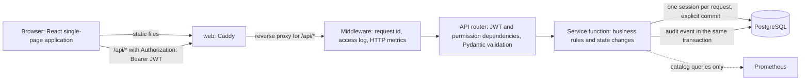
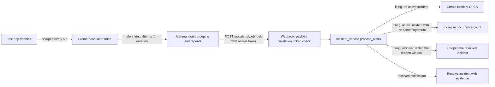
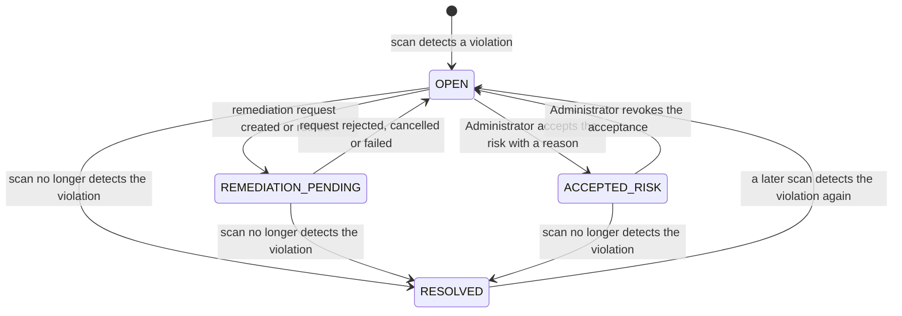
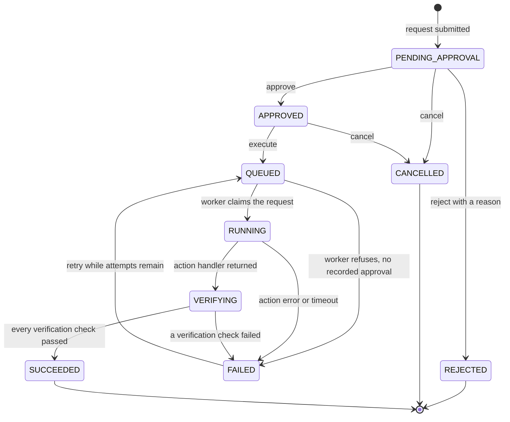

# VigilOps Architecture

This document describes how VigilOps: Secure Cloud Operations is built: its components, the main runtime flows, the layout of the backend, the database design, the state machines, the isolation of the remediation worker and the reasons behind the main design decisions. Everything here was written from the source code; file and function names are given so that each statement can be checked.

Related documents: [API reference](api.md) · [Security](security.md) · [Diagrams](diagrams/README.md) · [Setup](setup.md) · [Configuration](configuration.md) · [Deployment](deployment.md) · [Verification report](verification-report.md) · [Evaluation](evaluation.md) · [Phase 0 audit of the CloudShield prototype](phase-0-audit.md)

## Contents

- [System overview](#system-overview)
- [Components and responsibilities](#components-and-responsibilities)
- [Runtime flows](#runtime-flows)
- [Backend module layout](#backend-module-layout)
- [Frontend structure](#frontend-structure)
- [Database design](#database-design)
- [State machines](#state-machines)
- [Isolation model of the restricted worker](#isolation-model-of-the-restricted-worker)
- [Observability of the platform itself](#observability-of-the-platform-itself)
- [Key architectural decisions and trade-offs](#key-architectural-decisions-and-trade-offs)
- [Known limitations](#known-limitations)

## System overview

VigilOps is a single web application that combines five operational functions and one assistant:

1. **Monitoring** - live telemetry of monitored resources, read from Prometheus.
2. **Incident management** - incidents created from Prometheus alerts delivered by Alertmanager, with deduplication, a timeline and a validated lifecycle.
3. **Security scanning** - a deterministic scanner that evaluates local YAML configuration files against five rules (SEC-001 to SEC-005).
4. **Controlled remediation** - two allowlisted corrective actions that run only after Administrator approval, in a separate restricted worker, and count as successful only after verification.
5. **Audit logging** - an append-only record of every relevant event.
6. **VigilAI** - a read-only assistant backed by Google Gemini, shown as a floating chat widget.

All functions share one FastAPI backend, one PostgreSQL database, one login and one React user interface. The system is deployed with Docker Compose on a single host. That stack is the reference deployment and is what this document describes. A second, free-hosting deployment (API, worker, demo application, Prometheus and Alertmanager as separate processes in one container on Render, each under its own user where the host lets the container switch users; the frontend on Vercel) is described in [deployment-render-vercel.md](deployment-render-vercel.md).

What VigilOps deliberately is not: it does not connect to a cloud provider account, it does not run arbitrary commands, and it has no access to the Docker daemon or the host. The scanner reads local files in the `vigilops/v1` schema, and remediation is limited to the two actions in `backend/app/services/remediation_catalog.py`.

Diagrams: [system architecture](diagrams/system-architecture.md), [system context](diagrams/context.md), [deployment](diagrams/deployment.md), [data flow](diagrams/data-flow.md), [use cases](diagrams/use-case.md).

## Components and responsibilities

The services are defined in `compose.yaml`. All of them are attached to one bridge network named `internal`.

| Service | Image | Responsibility | State | Exposure |
|---|---|---|---|---|
| `web` | `caddy:2-alpine` plus the React production build (`frontend/Dockerfile`) | Public entry point. Serves the single-page application, sets security headers, and reverse-proxies `/api/*` to `backend:8000`; nothing else of the backend is routed. It also routes `/orbitcrate/*` to `test-app:8001`, limited to the storefront page, its static files and its store API (`/`, `/static/*`, `/api/*`); the application's `/internal/*`, `/metrics` and `/health/*` answer HTTP 404 there. | `caddy_data`, `caddy_config` volumes (TLS certificates in production) | Host port 8080 locally; 80 and 443 with the production overlay |
| `backend` | `python:3.11-slim` (`backend/Dockerfile`) | Runs `alembic upgrade head`, then Uvicorn with one worker process. REST API, Alertmanager webhook, incident engine, security scanner (read access only), remediation workflow up to QUEUED, audit queries, VigilAI, its own `/metrics`. | None of its own; mounts `scan_workspace` read-only | 127.0.0.1:8000 locally (API docs); no published port in production |
| `worker` | Same image as `backend`, command `python -m app.workers.remediation_worker` | Polls PostgreSQL for QUEUED remediation requests and demo tasks, executes the hard-coded action handlers, verifies the result, records outcomes, writes a heartbeat. | Read-write mount of `scan_workspace` | No ports |
| `postgres` | `postgres:16-alpine` | Operational database: users, incidents, findings, scans, remediation, audit, settings. | `pgdata` volume | No published port |
| `prometheus` | `prom/prometheus:v2.51.0` | Scrapes `test-app`, `backend`, itself and Alertmanager every 5 seconds, evaluates `monitoring/alert_rules.yml`, keeps 7 days of samples. | `prometheus_data` volume | 127.0.0.1:9090 locally; none in production |
| `alertmanager` | `prom/alertmanager:v0.27.0` | Groups alerts by `alertname` and `instance`, repeats firing notifications every 2 minutes, sends firing and resolved notifications to `POST /api/alerts/webhook`. The webhook token is mounted as a Compose secret file. | `alertmanager_data` volume | 127.0.0.1:9093 locally; none in production |
| `test-app` | `python:3.11-slim` (`test-app/Dockerfile`) | OrbitCrate, the monitored demonstration application: the storefront of a fictional cloud-hosting provider (plans, a price calculator, orders kept in memory per visitor). Real request, latency, CPU and memory metrics; a built-in load generator; token-protected fault injection (demo mode) and a token-protected recovery endpoint. | None | No published port; its storefront is reachable through `web` at `/orbitcrate/` |
| `workspace-init` | Same image as `backend`, runs as root with `network_mode: none` | One-shot: `chown -R 10001:10001` and `chmod 750` on the scan workspace volume so the unprivileged worker user can write to it, then exits. | - | None |

Start-up order is enforced with `depends_on` conditions: `backend` waits for a healthy `postgres` and a completed `workspace-init`; `worker` and `web` wait for a healthy `backend`. The worker additionally waits until the schema exists (`wait_for_schema`) because the backend applies the migrations.

On first start `app/services/bootstrap.py` creates only configuration records: the bootstrap Administrator and Operator accounts (if configured and not already present) and the two monitored resources `demo-app` and `vigilops-backend`. No incidents, findings, metrics or audit history are seeded.

## Runtime flows

### Request flow

Every user request passes through Caddy to the backend. Inside the backend a request goes through the middleware, the router with its dependencies, a service function and the database session.



Details:

- `request_context_middleware` in `app/main.py` assigns a correlation id (always a new UUID; an inbound `X-Request-ID` is deliberately not adopted, because the id becomes the default audit correlation id), stores it together with the client address in context variables, records the Prometheus counters and histogram using the route template as label, writes a structured access log line, and adds `X-Request-ID`, `Cache-Control: no-store` (for `/api`) and `X-Content-Type-Options: nosniff` to the response.
- `get_current_user` (`app/core/security.py`) verifies the JWT, loads the user, and checks the account is active, the token version matches and the token id is not revoked.
- `require_permission(...)` (`app/core/permissions.py`) enforces one permission from the central matrix and writes an `ACCESS_DENIED` audit event before returning HTTP 403.
- Service functions commit explicitly. `get_db` (`app/core/database.py`) rolls back on an exception and always closes the session.
- Errors are returned as JSON with `detail` and `request_id`; stack traces are never sent to clients (exception handlers in `app/main.py`).

### Alert-to-incident flow



How the engine decides (`app/services/incident_service.py`):

- **Identity.** The fingerprint supplied by Alertmanager is used; if it is missing, `compute_fingerprint` hashes the sorted label set.
- **Firing, active incident exists.** `occurrence_count` and `last_occurrence_at` are updated. The timeline does not grow by one row per repeat: an existing trailing `ALERT_REPEATED` event is updated in place.
- **Firing, recently resolved.** If an incident with the same fingerprint was RESOLVED within `incidents.reopen_window_minutes` (runtime setting, default 10), it is reopened. CLOSED incidents are never reopened.
- **Firing, otherwise.** A new incident is created. Severity is mapped from the `severity` label (`SEVERITY_MAP`, unknown values become MEDIUM), the monitored resource is looked up by the `resource` or `job` label, the suggested action is taken from the remediation catalog, and if a controlled demo fault is active on the demo application the incident is flagged `is_simulated`.
- **Resolved.** The active incident is moved to RESOLVED with the monitoring signal stored as evidence, and remediation requests that were not yet dispatched (PENDING_APPROVAL, APPROVED) are cancelled. If the incident was already resolved (for example by a verified remediation), only `alert_active` is cleared.
- **Atomicity and races.** Each alert of a batch runs in its own savepoint. If two deliveries of the same alert race, the partial unique index rejects the second insert and the alert is processed again as a repeat.

Timing is determined by configuration: the rule's `for` duration (15 s or 30 s in `monitoring/alert_rules.yml`), the 5 s evaluation interval, and Alertmanager's `group_wait` of 5 s. Measured values are in the [verification report](verification-report.md).

An incident whose alert is recorded as still firing but which has not received a repeat notification for 3 repeat intervals plus 60 seconds is reported with `signal_stale: true` (`signal_is_stale`), because silence from Alertmanager may mean the monitoring pipeline itself is unhealthy. The constant `ALERT_REPEAT_INTERVAL_SECONDS` must match `repeat_interval` in `monitoring/alertmanager.yml`.

### Security scan flow

Diagram: [security scanning flow](diagrams/security-scanning-flow.md).

1. `POST /api/security/scans` (permission `scans:run`) names one target or none (all files).
2. `scan_service.resolve_target` accepts only a plain `.yaml`/`.yml` file name and checks that the fully resolved path sits directly inside the scan workspace.
3. `security_scanner.engine.load_document` applies the size limit (`SCAN_MAX_FILE_BYTES`, 262144 bytes by default), rejects YAML anchors and aliases, parses with `yaml.safe_load` and validates the `vigilops/v1` structure.
4. `evaluate_document` runs every applicable rule on every resource. Rules are pure functions in `security_scanner/rules.py`; their metadata comes from `security-rules/policies.yaml`, and the loader refuses a catalog that does not describe exactly the implemented rule ids.
5. `scan_service._apply_file_results` reconciles violations with stored findings using the stable key `sha256(file | rule | resource type | resource name)`: insert, update, reopen or resolve.
6. The scan row, the finding changes and their audit events are committed together.

The engine has no database access; `scan_service` adds authorised-path handling, history and the finding lifecycle. The worker calls the same `run_scan` to verify ACTION-002.

### Remediation flow

Diagram: [remediation sequence](diagrams/remediation-sequence.md).

1. **Request** (`remediation:request`, both roles). `remediation_service.create_request` checks that the action code is in the catalog, that it matches the source type, that it is applicable to this incident or finding (`action_for_incident`, `action_for_finding`) and that no other request for the same source is in flight. The request starts in PENDING_APPROVAL; a finding moves to REMEDIATION_PENDING.
2. **Decision** (`remediation:approve`, Administrator). Approve or reject. By default an Administrator cannot approve a request they submitted (`remediation.allow_self_approval`).
3. **Dispatch** (`remediation:execute`, Administrator). `execute` moves APPROVED to QUEUED. The API process never performs the corrective action.
4. **Claim.** The worker's `claim_next` selects the oldest QUEUED row with `FOR UPDATE SKIP LOCKED`, refuses it if no approver is recorded, otherwise sets RUNNING, increments `attempt_count` and inserts a `remediation_executions` row, all in one transaction.
5. **Execute.** The handler for the action code runs with a timeout (`ACTION_TIMEOUT_SECONDS`, 30 s). Its parameters are built from database records only (`_build_params`).
6. **Verify.** The verifier for the action code gathers fresh evidence (`app/workers/verification.py`):
   - ACTION-001: three consecutive successful readiness probes of the demo application, a healthy Prometheus scrape of the target that is newer than the action, and the incident's alert no longer firing in Prometheus. The overall budget is `VERIFY_TIMEOUT_SECONDS` (150 s).
   - ACTION-002: a persisted re-scan of the corrected file, an independent re-evaluation showing the rule no longer matches the resource, and the finding's status having been set to RESOLVED by that scan.
7. **Outcome.** SUCCEEDED resolves the linked incident with the verification checks as evidence. FAILED records the reason, returns a REMEDIATION_PENDING finding to OPEN and leaves the incident active. An Administrator may retry a FAILED request while `attempt_count < max_attempts` (`REMEDIATION_MAX_ATTEMPTS`, 3).

All audit events of one request share its `correlation_id`, which is how the request detail page builds its timeline.

### VigilAI flow

Diagram: [VigilAI architecture](diagrams/vigilai-architecture.md).

`assistant.service.chat` runs these steps for `POST /api/assistant/chat`:

1. Normalise the message and cut it to `AI_MAX_INPUT_CHARS`; return a fixed reply if the runtime setting `assistant.enabled` is off.
2. Apply the per-user rate limit (`AI_RATE_LIMIT_PER_MINUTE`); exceeding it returns HTTP 429.
3. Classify the message with `scope.classify`: in scope, out of scope, privileged action, secret request or prompt injection. Anything but "in scope" gets a fixed refusal; the last three are also written to the audit trail.
4. Retrieve up to four matching sections of the Markdown knowledge base with BM25 (`retrieval.KnowledgeBase.search`).
5. Select read-only context tools with deterministic keyword routing (`context_tools.select_tools`) and run them with the caller's permissions.
6. If neither documentation nor live data was found, refuse as out of scope.
7. If Gemini is configured and the server-wide daily budget is not exhausted, build the prompt (`prompts.build_prompt`) and call the provider (`gemini_provider.GeminiProvider`, model from `GEMINI_MODEL`).
8. Validate and sanitise the reply (`sanitize.validate_reply`).
9. If the provider is not configured, fails, times out, is rate limited or returns nothing, compose the documentation fallback from the same documentation and live data, with a notice that live AI generation is unavailable.

Nothing in the assistant package changes platform state. The provider is behind a small interface (`assistant/providers.py`), so the vendor or model can be changed through configuration.

Verification status: scope validation, retrieval, tool routing, validation and the fallback path are covered by the automated tests in `backend/tests`. Live Gemini generation was verified on 2026-11-23 with a real API key and the default model `gemini-3.5-flash-lite` by `scripts/verify_gemini_live.py`: 19 of 19 checks passed and 9 of 9 platform questions were answered in `ai` mode (evidence in [`evidence/gemini-live.json`](evidence/gemini-live.json)). Real quota exhaustion (HTTP 429 from the provider) and provider timeouts were not observed; those paths are covered only by tests with a stubbed SDK client. See the [verification report](verification-report.md).

## Backend module layout

```
backend/
  alembic/                      migrations (0001_initial_schema.py)
  app/
    main.py                     application object, middleware, error handlers, health and /metrics
    api/                        HTTP layer: one router per area
      router.py                 mounts every router under /api
      deps.py                   pagination parameters and the response envelope
      auth.py  users.py  monitoring.py  incidents.py  security.py
      remediation.py  audit.py  assistant.py  settings.py  demo.py
    schemas/schemas.py          Pydantic request and response models
    services/                   business logic and data access
      incident_service.py       alert ingestion, deduplication, lifecycle
      scan_service.py           authorised targets, scan history, finding lifecycle
      remediation_service.py    request workflow up to QUEUED
      remediation_catalog.py    allowlist of actions and their applicability
      monitoring_service.py     Prometheus and Alertmanager client, metric catalog
      audit_service.py          record_audit, visibility rules, queries
      dashboard_service.py      aggregated counts, worker status
      settings_service.py       runtime settings with types and bounds
      recommendations.py        static runbooks per alert and per rule
      demo_service.py           fault injection and sample reset (demo mode)
      bootstrap.py              first-start accounts and monitored resources
    security_scanner/           pure scanner: engine.py (loading, validation), rules.py (SEC-001..005)
    assistant/                  VigilAI: service, scope, retrieval, context_tools, prompts,
                                providers, gemini_provider, sanitize
    workers/                    restricted worker: remediation_worker, actions, verification, healthcheck
    core/                       config, database, security, permissions, rate_limit,
                                request_context, logging, metrics
    models/models.py            SQLAlchemy models and status enumerations
```

### Layering rule

| Layer | Location | May do | Must not do |
|---|---|---|---|
| Routing | `app/api/*.py` | Declare paths, validate input with schemas, enforce permissions with `require_permission`, call a service, translate service exceptions into HTTP status codes, shape the response | Contain state machines or decide business outcomes |
| Business logic | `app/services/*.py`, `app/assistant/*.py`, `app/workers/*.py` | Apply rules and state transitions, write audit events, commit the transaction | Know about HTTP (services raise their own exceptions: `IncidentError`, `RemediationError`, `ScanTargetError`, `FindingStateError`, `MetricRequestError`, `SettingError`, `DemoError`) |
| Data access | `app/models/models.py`, `app/core/database.py` | Define tables, constraints and the session | Contain workflow rules |
| Pure logic | `app/security_scanner/*.py` | Parse and evaluate documents | Touch the database or the network |

Why: the same service functions are called by three different entry points - the REST API, the worker and the assistant's context tools. Keeping the rules out of the routers means the worker resolves an incident with exactly the code a human uses (`incident_service.resolve_incident`), and VigilAI sees audit events through the same visibility filter as the audit page (`audit_service.list_audit_events`).

The rule is followed for incidents, scanning, remediation, settings, monitoring and the assistant. Two small areas keep their queries and rules in the router itself: sign-in (`api/auth.py`) and user management (`api/users.py`).

## Frontend structure

The user interface is a React 18 single-page application built with Vite and styled with Tailwind CSS (`frontend/src`).

| Folder | Content |
|---|---|
| `api/` | `client.js` (Axios instance, token store, 401 handling, error messages) and one module per backend area |
| `context/` | `AuthContext` (session restore through `/api/auth/me`, `can(permission)` hint), `ThemeContext`, `ToastContext` |
| `hooks/useApi.js` | Data loading with loading, error and retry state; optional polling that pauses while the tab is hidden |
| `hooks/useServerStatus.js` | Availability probe used by the sign-in page: asks `/api/health` through `api/health.js` whether the backend is answering |
| `layouts/AppLayout.jsx` | Sidebar, header, page outlet and the floating VigilAI widget |
| `pages/` | Overview, Monitoring, Incidents, Security Findings, Remediation, Audit Logs, VigilAI / Help, Settings, Login and the detail pages |
| `features/vigilai/` | `VigilAIWidget`, `VigilAIChat`, `SafeText` (renders assistant text as React text nodes, never as HTML) |

The frontend calls only same-origin `/api` paths. Permission checks in the interface (`can(...)`) are hints that hide or disable controls; the backend enforces every permission again.

## Database design

PostgreSQL 16 is the operational store. The schema is created by one Alembic migration (`backend/alembic/versions/0001_initial_schema.py`) from the models in `backend/app/models/models.py`. The entity-relationship diagram is in [diagrams/er-diagram.md](diagrams/er-diagram.md).

Conventions (stated in the module docstring of `models.py`):

- Every timestamp is timezone-aware UTC (`UTCDateTime`), so there is one clock and no local-time ambiguity.
- Status and severity columns hold upper-case string constants that are also enforced with CHECK constraints, so an invalid state cannot be stored even by a bug.
- Deduplication keys are enforced by the database with unique and partial unique indexes, not only by application code, so concurrent requests cannot create duplicates.

### Tables

| Table | Purpose | Key columns | Constraints and indexes |
|---|---|---|---|
| `users` | Accounts of Administrators and Operators | `email`, `password_hash` (bcrypt), `role`, `is_active`, `token_version`, `last_login_at` | Unique index on `email`; CHECK `role IN ('admin','operator')`. `token_version` is incremented on password change, role change or (de)activation, which invalidates every token issued before |
| `revoked_tokens` | JWT ids revoked by an explicit logout, kept until their natural expiry | `jti` (primary key), `user_id`, `expires_at`, `revoked_at` | FK to `users` with ON DELETE CASCADE; index on `expires_at` for the clean-up of expired rows |
| `monitored_resources` | Registry of resources whose telemetry may be queried | `name`, `resource_type`, `environment`, `monitoring_identifier` (Prometheus `job`), `status` (last observed UP, DOWN or UNKNOWN), `status_checked_at` | Unique `name`; unique `monitoring_identifier`. The timeseries API accepts only jobs registered here |
| `incidents` | One row per operational problem | `title`, `severity`, `status`, `alert_name`, `alert_fingerprint`, `resource_id`, `affected_resource`, `labels`, `annotations`, `action_code`, `is_simulated`, `alert_active`, `occurrence_count`, `detected_at`, `last_occurrence_at`, `acknowledged_at`, `resolved_at`, `closed_at`, `resolution_summary` | CHECK on `status` and `severity`; FK `resource_id` ON DELETE SET NULL; composite index (`status`, `severity`); partial unique index `uq_incidents_active_fingerprint` |
| `incident_events` | Timeline of an incident | `incident_id`, `actor_id`, `actor_label`, `event_type`, `previous_state`, `new_state`, `details`, `metadata`, `created_at`, `updated_at` | FK `incident_id` ON DELETE CASCADE; FK `actor_id` ON DELETE SET NULL. `updated_at` exists because a repeated-alert event is updated in place |
| `security_scans` | Scan history | `requested_by`, `requested_by_label`, `trigger` (MANUAL, REMEDIATION_VERIFICATION, DEMO_RESET), `target` (`*` means all files), `status`, `started_at`, `completed_at`, `result_summary`, `error` | CHECK `status IN ('RUNNING','COMPLETED','FAILED')`; index on `started_at` |
| `security_findings` | One row per rule violation on one resource of one file | `stable_finding_key`, `scan_id` (first detection), `last_scan_id`, `rule_id`, `rule_name`, `severity`, `target_file`, `resource_type`, `resource_name`, `resource_identifier`, `evidence`, `recommendation`, `status`, `detection_count`, `first_detected_at`, `last_seen_at`, `resolved_at`, `accepted_risk_by`, `accepted_risk_reason`, `accepted_risk_at` | Unique `stable_finding_key`; CHECK on `status` and `severity`; composite index (`status`, `severity`) |
| `remediation_requests` | Remediation workflow state; also the worker's queue | `correlation_id`, `source_type`, `incident_id`, `finding_id`, `action_code`, `target`, `requested_by`, `approved_by` (who approved or rejected), `status`, `justification`, `decision_comment`, `attempt_count`, `max_attempts`, `failure_reason`, `decided_at`, `queued_at`, `started_at`, `completed_at` | CHECK on `status` and `source_type`; CHECK `ck_remediation_single_source` (exactly one of `incident_id`, `finding_id`); FKs to incidents, findings and users with ON DELETE RESTRICT; partial unique indexes `uq_remediation_active_incident` and `uq_remediation_active_finding` |
| `remediation_executions` | One row per execution attempt | `request_id`, `attempt`, `worker_identifier`, `status` (RUNNING, VERIFYING, SUCCEEDED, FAILED), `execution_details`, `verification_result`, `error`, `started_at`, `completed_at` | Unique (`request_id`, `attempt`); FK ON DELETE CASCADE |
| `audit_events` | Append-only audit trail | `event_id` (UUID), `actor_id`, `actor_label`, `action`, `entity_type`, `entity_id`, `outcome`, `metadata`, `correlation_id`, `source_ip`, `created_at` | Unique `event_id`; CHECK `outcome IN ('SUCCESS','FAILURE','DENIED')`; indexes on (`entity_type`, `entity_id`), `action`, `actor_id`, `correlation_id`, `created_at`, `outcome`; append-only trigger on PostgreSQL |
| `system_settings` | Runtime-tunable settings | `key` (primary key), `value` (JSON), `updated_by`, `updated_at` | Only the keys declared in `settings_service.SETTING_DEFINITIONS` are read or written; a stored value that fails its type or bounds check is ignored in favour of the default |
| `worker_heartbeats` | Liveness of the worker | `worker_id` (primary key), `hostname`, `version`, `started_at`, `last_seen_at`, `jobs_processed` | Read by the UI (online when seen within 45 s) and by the worker's container health check (60 s) |
| `demo_tasks` | Demo-environment maintenance queued for the worker | `task_type`, `status` (QUEUED, RUNNING, SUCCEEDED, FAILED), `requested_by`, `details`, `error` | Index on `status`. Exists because the API mounts the scan workspace read-only and therefore cannot restore the sample file itself |

Alembic adds its own `alembic_version` table.

### Partial unique indexes and why they exist

| Index | Definition | Reason |
|---|---|---|
| `uq_incidents_active_fingerprint` | UNIQUE on `incidents(alert_fingerprint)` WHERE `status IN ('OPEN','ACKNOWLEDGED','IN_PROGRESS')` | Deterministic deduplication: at most one active incident per alert. A plain unique index would be wrong, because the same alert may legitimately produce a new incident after the previous one was resolved or closed. `process_alerts` relies on it to survive concurrent deliveries |
| `uq_remediation_active_incident` | UNIQUE on `remediation_requests(incident_id)` WHERE `incident_id IS NOT NULL AND status IN ('PENDING_APPROVAL','APPROVED','QUEUED','RUNNING','VERIFYING')` | Idempotency: at most one in-flight request per incident, while any number of finished requests (REJECTED, CANCELLED, SUCCEEDED, FAILED) may remain as history |
| `uq_remediation_active_finding` | The same for `finding_id` | The same for findings |

`create_request` and `retry` catch the resulting `IntegrityError` and return HTTP 409.

### PostgreSQL-only safeguards in the initial migration

- **Append-only audit trail.** The function `vigilops_audit_events_immutable()` and the trigger `trg_audit_events_immutable` (BEFORE UPDATE OR DELETE, FOR EACH ROW) raise an exception for any update or delete on `audit_events`. Reason given in the migration: audit history cannot be rewritten "even by a bug in the application".
- **Preservation of legacy CloudShield data.** If the database contains the prototype's marker tables (`remediation_jobs` or `audit_logs`), the prototype's tables are moved with `ALTER TABLE ... SET SCHEMA` into the schema `legacy_cloudshield` before the new tables are created. `SET SCHEMA` moves indexes, constraints and owned sequences with the table, so no data is copied or lost.

Both steps are skipped on SQLite, which is used only by the fast test suite. The suite also runs against PostgreSQL in CI, and `backend/tests/integration/test_postgres.py` exercises the trigger and the legacy-table move against a real PostgreSQL database; results are in the [verification report](verification-report.md).

## State machines

### Incidents

Diagram: [incident lifecycle](diagrams/incident-lifecycle.md). Source: `incident_service.TRANSITIONS` and `transition_incident`.

| From | To | Who | Conditions |
|---|---|---|---|
| (new) | OPEN | Alertmanager webhook | Firing alert with no active incident for its fingerprint |
| OPEN | ACKNOWLEDGED | Operator, Administrator (`incidents:update`) | - |
| OPEN, ACKNOWLEDGED | IN_PROGRESS | Operator, Administrator | `acknowledged_at` is set if it was empty |
| OPEN, ACKNOWLEDGED, IN_PROGRESS | RESOLVED | Operator, Administrator | Note of at least 10 characters; if the alert is recorded as active, Prometheus must report it as not firing; only when Prometheus cannot be queried may an Administrator set `override_monitoring` |
| OPEN, ACKNOWLEDGED, IN_PROGRESS | RESOLVED | Alertmanager (resolved notification) | Automatic, evidence is the monitoring signal |
| OPEN, ACKNOWLEDGED, IN_PROGRESS | RESOLVED | Worker | Remediation verification passed |
| RESOLVED | CLOSED | Administrator (`incidents:close`) | - |
| RESOLVED | OPEN | Administrator (`incidents:close`) | Reason of at least 10 characters |
| RESOLVED | OPEN | Alertmanager (firing again) | Within `incidents.reopen_window_minutes` of the resolution |
| CLOSED | - | - | Terminal |

Any other transition returns HTTP 409 with the list of allowed targets. A transition refused for lack of `incidents:close` returns HTTP 403 and is audited as `INCIDENT_STATUS_CHANGE_DENIED`.

### Security findings

Source: `scan_service._apply_file_results`, `accept_risk`, `revoke_risk_acceptance`, and the finding updates in `remediation_service.py` and `workers/remediation_worker.py`.



A finding is never deleted and never set to RESOLVED by hand: only a scan that evaluated the file and did not detect the violation resolves it. While a violation is still detected, a finding in REMEDIATION_PENDING or ACCEPTED_RISK keeps its status.

### Remediation requests

Source: the module docstring and functions of `remediation_service.py` (API side) and `claim_next`, `run_execution`, `recover_interrupted` in `workers/remediation_worker.py` (worker side).



| Transition | Performed by | Permission or rule |
|---|---|---|
| create | Operator or Administrator | `remediation:request`; allowlisted and applicable action; no other active request for the source |
| approve | Administrator | `remediation:approve`; not the requester unless `remediation.allow_self_approval` is on |
| reject | Administrator | `remediation:approve`; reason of at least 5 characters |
| cancel | Requester or Administrator | `remediation:cancel`; only from PENDING_APPROVAL or APPROVED. Also done automatically when the incident is resolved before dispatch |
| execute | Administrator | `remediation:execute`; only from APPROVED |
| claim, run, verify | Worker | Only QUEUED rows with a recorded approver |
| retry | Administrator | `remediation:execute`; only from FAILED, `attempt_count < max_attempts`, source still unresolved |

The "active" states (PENDING_APPROVAL, APPROVED, QUEUED, RUNNING, VERIFYING) are the ones covered by the partial unique indexes. When the worker starts it marks requests left in RUNNING or VERIFYING by a previous worker process as FAILED with the reason that the outcome is unknown (`recover_interrupted`).

## Isolation model of the restricted worker

The worker exists so that the component reachable from the network (the API) is not the component able to change things. The reasons are stated in `knowledge_base/architecture.md` and in the docstrings of `workers/remediation_worker.py` and `workers/actions.py`.

| Property | How it is implemented |
|---|---|
| No inbound interface | No `ports` in `compose.yaml`; the process opens no listening socket. Its only input is the `remediation_requests` and `demo_tasks` tables |
| Only writer of the scan workspace | `scan_workspace` is mounted read-write in `worker` and read-only (`:ro`) in `backend` |
| Only platform component holding the recovery token | `DEMO_APP_RECOVERY_TOKEN` is passed to `worker` (and to `test-app`, which must verify it) but not to `backend` |
| No API secrets | `PROCESS_ROLE=worker`: the configuration does not require `SECRET_KEY` or `ALERT_WEBHOOK_TOKEN`, and Compose does not pass them, nor the Gemini key, the bootstrap passwords or the demo control token |
| Reduced container privileges | `read_only: true` root filesystem with a `tmpfs` at `/tmp`, `cap_drop: [ALL]`, `no-new-privileges`, non-root user uid 10001 |
| Fixed set of actions | One hard-coded handler per code in `actions.HANDLERS`; an assertion at import time requires the handlers to equal the published catalog. A request carries only an action code, never a command, script or path |
| Trusted parameters | `_build_params` builds the handler input from the finding or incident row, not from free text |
| Approval re-checked | `claim_next` refuses a QUEUED row without `approved_by` and records `REMEDIATION_EXECUTION_REFUSED` |
| Confined file access | ACTION-002 resolves its target through the remediation allowlist (`REMEDIATION_WRITABLE_TARGETS`) and the same path confinement as the scanner, and writes through a temporary file followed by an atomic rename |
| Bounded execution | Action timeout, verification timeout, at most three attempts of the recovery call inside ACTION-001, bounded request attempts |
| No shell, no Docker | No handler starts a process or talks to the Docker daemon. Consequence: ACTION-001 can recover a failed service component but cannot start a stopped container |

What this buys: a bug in, or a compromise of, the API process cannot directly edit a configuration file or call the recovery endpoint. What it does not buy is described in [security.md](security.md#residual-risks-and-limitations): the API and the worker use the same database role, so the queue itself is protected by application logic and not by database permissions.

## Observability of the platform itself

- **Metrics.** The backend exposes `/metrics` (scraped by Prometheus as job `vigilops-backend`, never routed by Caddy): `http_requests_total`, `http_request_duration_seconds`, and the `vigilops_*` counters and gauges defined in `app/core/metrics.py`. Route templates are used as labels to keep cardinality bounded.
- **Logs.** Single-line JSON on standard output with the request id, passed through a redaction filter (`app/core/logging.py`).
- **Health.** `/health/live` (process is running), `/health/ready` (database reachable and migrations applied, HTTP 503 otherwise) and `/api/health` (combined summary, reachable through the proxy).
- **Worker liveness.** A heartbeat row, shown in the user interface and used by the container health check.

## Key architectural decisions and trade-offs

| Decision | Reason | Trade-off accepted |
|---|---|---|
| **Modular monolith**, not microservices. One backend package with clear modules; the only second process is the worker | All modules share one database and one login, and a state change and its audit event must commit in one transaction (`audit_service.record_audit` joins the caller's transaction). The one process boundary that exists is placed where it gives a security property: between deciding and executing remediation | The modules scale together and share one failure domain |
| **Database polling queue** (`SELECT ... FOR UPDATE SKIP LOCKED` on `remediation_requests`) instead of a message broker | The queue entry is the workflow record itself, so claiming a job, changing its state and writing the audit event are one atomic transaction, and there is no second system that can disagree with the database. No extra service to run | Pick-up latency of up to `WORKER_POLL_INTERVAL_SECONDS` (2 s); a constant trickle of polling queries; designed for one worker |
| **BM25 keyword retrieval** in plain Python instead of a vector database | Stated in `assistant/retrieval.py`: the corpus is a few dozen chunks, queries are dominated by exact domain terms such as `SEC-001` and `Alertmanager`, and lexical ranking is deterministic, explainable and needs no extra service | No semantic matching: a question that uses none of the documentation's words finds nothing |
| **Prometheus is the only source of telemetry**. The backend stores no metric samples and never substitutes a value | Stated in `services/monitoring_service.py`: every number shown comes from a Prometheus query, and when a value cannot be obtained the result says so (`available: false` with a reason). This removes the prototype's invented defaults and seeded metric history ([phase-0-audit.md](phase-0-audit.md)) | When Prometheus is down the monitoring pages show "unavailable"; history is limited to Prometheus retention (7 days) |
| **Metric catalog instead of free PromQL** | The browser can request metrics only by key from `METRIC_CATALOG`, for a job registered in `monitored_resources`, with a preset range. Arbitrary PromQL from a browser would be an injection and denial-of-service surface | New charts need a code change |
| **In-process rate limiting** (`core/rate_limit.py`) | Stated in the module: the backend runs as a single process, so an in-memory sliding window is sufficient and avoids introducing Redis; a restart only makes the limiter more permissive for one window | Requires `--workers 1`; state is lost on restart; not shared across replicas |
| **Access token in `sessionStorage`**, sent in the `Authorization` header | Stated in `frontend/src/api/client.js`: it disappears when the tab closes and is never a cookie, so there is no cross-site request forgery surface and CORS can stay off | Script running in the page could read it; mitigated by the Content-Security-Policy, by never rendering HTML from data, by the 60-minute expiry and by server-side revocation |
| **Approve and execute are separate steps** | The prototype allowed execution of a job that was still pending ([phase-0-audit.md](phase-0-audit.md), row 17). Two explicit transitions with separate permissions make the approval impossible to skip and give the Administrator control over timing | One more click per remediation |
| **Deterministic tool routing for VigilAI** instead of model-driven function calling | Stated in `assistant/context_tools.py`: the language model does not choose or parameterise the live-data functions, so a manipulated model cannot widen what is read | Routing is keyword based and can miss or over-select tools |
| **Static runbooks**, not AI-generated recommendations | Stated in `services/recommendations.py`: guidance next to an incident or finding is version-controlled, deterministic and auditable | Guidance exists only for the known alerts and rules |
| **Evidence-based resolution** | An incident or finding becomes RESOLVED only through a monitoring signal, a verification result or a scan; the prototype marked problems fixed when the action returned ([phase-0-audit.md](phase-0-audit.md), row 19) | Verification of ACTION-001 can take up to the verification timeout |
| **Same-origin deployment behind Caddy** | The frontend and `/api` share one origin, so CORS is disabled unless `CORS_ORIGINS` is set, and Caddy provides TLS in production | The backend must not be exposed directly |

## Known limitations

- **Scanner scope.** The scanner evaluates local YAML files in the `vigilops/v1` schema. It is not a live cloud assessment, and there is no API to upload files: files reach the workspace through the demo baseline (demo mode) or by being placed in the volume by the host operator. In production mode the workspace is not seeded, unless the hosted-demonstration opt-in `ALLOW_DEMO_CONTROLS_IN_PRODUCTION` is set.
- **Two automated actions.** Only ACTION-001 (recover the demo application) and ACTION-002 (correct public storage access for SEC-001) exist. ACTION-001 cannot start a stopped container.
- **Fixed monitored resources.** Resources are registered at bootstrap (`demo-app`, `vigilops-backend`); there is no API to add one, and the alert rules target the job `demo-app`.
- **Single instance.** One backend process and one worker. Rate limiters, the monitoring cache and the assistant's daily budget live in memory and reset on restart. There is no high availability for PostgreSQL or the host.
- **One job at a time.** The worker processes queued requests sequentially; while one verification is running (up to `VERIFY_TIMEOUT_SECONDS`) other queued requests wait. Liveness is reported by a separate heartbeat thread (`HeartbeatThread`), so a long verification does not make the worker appear offline or its container unhealthy.
- **Action timeout.** The timeout stops waiting for a handler but cannot kill its thread; a handler that exceeds it may still finish in the background after the request was marked FAILED.
- **ACTION-002 rewrites the file.** The corrected document is re-serialised with `yaml.safe_dump`; only the leading comment block is preserved, other comments and the original formatting are not. The before/after diff is stored with the execution.
- **Removed files.** A scan reconciles findings only for files it scanned. Findings of a file that was removed from the workspace keep their status (a deleted file is not a verified fix); a full-workspace scan reports their number as `orphaned_findings` in its summary.
- **Retry requires an OPEN finding.** Retrying a FAILED request is refused (HTTP 409) when its finding is no longer OPEN, for example because it was marked ACCEPTED_RISK after the failure.
- **Worker-side metrics.** Counters incremented in the worker process (for example remediation transitions to RUNNING or SUCCEEDED) are not exposed, because the worker has no metrics endpoint; the gauges for open incidents and open findings are refreshed only by the API process.
- **Repeat interval is configured twice.** The Alertmanager repeat interval lives in `monitoring/alertmanager.yml`; the backend setting `ALERT_REPEAT_INTERVAL_SECONDS` (default 120) must be given the same value, because it is used to decide when an alert signal is stale.
- **Roles.** Two fixed roles, no per-object ownership beyond "own remediation request", no multi-tenancy, no multi-factor authentication.
- **VigilAI.** Scope validation and tool routing are keyword and pattern based. Live Gemini generation was verified with one model on a small question set, using keyword grounding checks and a reading of the replies; there was no systematic human evaluation of answer quality. Real quota exhaustion (HTTP 429 from the provider) was never observed.
- **Security-related limitations** (shared database role, flat network, forwarded headers and others) are listed in [security.md](security.md#residual-risks-and-limitations).
