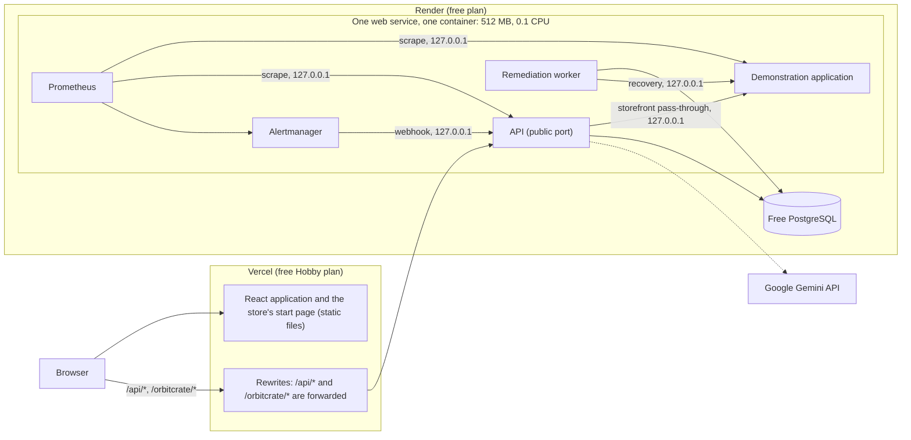

# Free hosting: Render (backend) and Vercel (frontend)

This is a second way to run VigilOps, for a public demonstration at no cost. The reference deployment is
still the Docker Compose stack ([`deployment.md`](deployment.md)); read the section "What is different
from the Compose stack" before relying on this one for anything but a demonstration.

Related: [Configuration](configuration.md) · [Security](security.md) · [Verification report](verification-report.md)

## How it is laid out



Why one container: Render's free plan offers web services and one PostgreSQL database, but no background
workers, no private services, no network between free services and no disks. The API and the worker must
share the scan workspace, and Prometheus must reach its targets, so everything except the database and
the frontend runs in a single web service:

| File | Purpose |
|---|---|
| [`render.yaml`](../render.yaml) | Render Blueprint: the web service, the database and every setting |
| [`deploy/render/Dockerfile`](../deploy/render/Dockerfile) | The single-container image |
| [`deploy/render/launcher.py`](../deploy/render/launcher.py) | Starts and supervises the five processes inside it |
| [`frontend/vercel.json`](../frontend/vercel.json) | Vercel build settings, the `/api` and `/orbitcrate` rewrites, the rule that serves the store's start page, the `/wake` redirect through which a page starts the sleeping service, and the security headers |
| [`frontend/public/orbitcrate-start.html`](../frontend/public/orbitcrate-start.html), [`orbitcrate-start.js`](../frontend/public/orbitcrate-start.js) | The store's start page: what a visitor sees at `/orbitcrate/` while the Render service is still starting |

Inside the container the components are still separated as far as one container allows:

- each runs as its own unprivileged user (`vigilops`, `vigilworker`, `demoapp`, `monitoring`);
- the scan workspace belongs to the worker; the API can read it through its group and cannot write it;
- each process receives only the environment variables it needs: the API never sees the recovery token,
  the worker never sees `SECRET_KEY`, the Gemini key or the webhook token, Prometheus and Alertmanager see
  no secret (Alertmanager reads the webhook token from a file only its user can read);
- the demonstration application, Prometheus and Alertmanager listen on `127.0.0.1` only. The API port is
  the only public port, and `/metrics` and `/health/ready` answer only the Prometheus process inside the
  container (`INTERNAL_ENDPOINTS_LOCAL_ONLY=true`);
- OrbitCrate, the demonstration application's storefront, is reachable at `/orbitcrate/` because the API
  passes it through (`SERVE_DEMO_APP=true`, set in the image): the page, its static files and its store
  API only. The application's control endpoints, `/metrics` and `/health/*` are never passed on.

This separation needs a host that lets the container start as root and switch users. If it does not,
the launcher runs every component as the one user it was given and writes a line starting with
`[launcher] WARNING` to the log; the platform works the same, without the per-user separation. Check the
first lines of the service log after the first deploy to see which case applies.

The monitoring configuration is not duplicated: the launcher uses `monitoring/prometheus.yml`,
`monitoring/alert_rules.yml` and `monitoring/alertmanager.yml` and only replaces the Compose host names
with `127.0.0.1`.

## What the free plans mean for you

| Fact (from the providers' documentation, read on 2026-11-23) | Consequence |
|---|---|
| A free Render web service is stopped after 15 minutes without incoming requests and takes about a minute to start again. Requests made inside the container (the synthetic load, the Prometheus scrapes) do not count | The first visit after a pause is slow. The product page and the sign-in page say that the server is starting, the store's address shows a start page, and all three continue by themselves (see "While the service is starting"). To avoid the pause altogether, see "Keeping the service awake" |
| Measured on 2026-11-25, not stated in the documentation: a sleeping service is not started by a request that Vercel forwards to it. Render answers such a request with its "502 Bad Gateway" page. A request to the Render address itself starts the service | While they wait, the pages also send one request straight to the Render address (the `/wake` address, see "While the service is starting"). Without it a visitor would wait until somebody else asked the Render address |
| When it stops, its files are lost | Prometheus history, the Alertmanager state, an injected fault and any change to the sample configuration are gone after a pause. Incidents, findings, remediation requests, users and the audit trail are in PostgreSQL and stay |
| A free Render PostgreSQL database expires 30 days after it was created; 14 days later it is deleted. Only one free database per workspace | Plan the demonstration inside those 30 days, or see "When the database expires". If your Render workspace already has a free database, the Blueprint cannot create a second one |
| A free web service has 0.1 CPU and 512 MB | Sign-in takes several seconds (password hashing). The `cpu` and `memory` faults are switched off because the whole container would stall or be killed; `outage`, `errors` and `latency` work |
| 750 free instance hours per workspace and month, shared by all free services. When they are used up, Render suspends every free web service of the workspace until the next month | Enough for one service that is always awake (a month has at most 744 hours); not enough if other free services run in the same workspace |
| Vercel waits up to 120 seconds for the backend when it forwards a request | Long enough for the backend to wake up |

Nothing here requires a payment method, and nothing in this repository enables billing. If a provider asks
for a card or shows a price, stop: that is not this setup.

## Steps

You need a Render account and a Vercel account, both connected to the GitHub account that owns the
repository.

### 1. Backend on Render

1. Open the deploy link below, or in the Render Dashboard choose **New** and then **Blueprint** and
   select the `VigilOps` repository. Render reads `render.yaml` and lists one web service (`vigilops`)
   and one database (`vigilops-db`).

   [](https://render.com/deploy?repo=https://github.com/Gangadhar017/VigilOps)
2. Render asks for three values. They are typed here and stored only by Render:

   | Variable | What to enter |
   |---|---|
   | `BOOTSTRAP_ADMIN_PASSWORD` | Password of the first Administrator (`admin@vigilops.local`). At least 10 characters with an upper-case letter, a lower-case letter and a digit |
   | `BOOTSTRAP_OPERATOR_PASSWORD` | Password of the first Operator (`operator@vigilops.local`). Same rule; use a different one |
   | `GEMINI_API_KEY` | Your Google Gemini API key. Without one VigilAI works in documentation mode |

   If a password does not meet the rule the service refuses to start and the deploy log says which
   variable is wrong.
3. Apply the Blueprint. The first build takes several minutes. When the service is **Live**, open
   `https://<service>.onrender.com/api/health`; it must show `{"status":"healthy"}`.
4. Note the address. `render.yaml` names the service `vigilops`, so it is `https://vigilops.onrender.com`
   if that name was still free; otherwise Render appends a suffix.

All other secrets (`SECRET_KEY`, the webhook token, the two demo-application tokens) are generated by
Render. The region is `singapore` for both the service and the database; they must be the same, and a
region cannot be changed after creation, so edit `render.yaml` first if you want another one.

### 2. Frontend on Vercel

1. If the Render address is not `https://vigilops.onrender.com`, replace it everywhere in
   `frontend/vercel.json` and push the change. It occurs five times: in the `destination` of the three
   rewrites that point to it (`/api/:path*`, `/orbitcrate/open` and `/orbitcrate/:path(.*)`), in the
   `destination` of the `/wake` redirect, and in `connect-src` of the `Content-Security-Policy` header.
2. In Vercel choose **Add New**, **Project**, and import the `VigilOps` repository.
3. Set **Root Directory** to `frontend`. The other settings come from `frontend/vercel.json` (build
   command `npm run build`, output directory `dist`). No environment variables are needed.
4. Deploy. Open the address Vercel shows and sign in with `admin@vigilops.local` and the password you chose.

The browser reads only from the Vercel address; Vercel forwards `/api/*` and `/orbitcrate/*` to Render.
The frontend therefore needs no backend address at build time and the backend needs no CORS setting.
One request goes to the Render address directly: the one that starts a sleeping service (see "While
the service is starting"). Its answer is not read.

One address below `/orbitcrate/` is not forwarded: the store's own address, `/orbitcrate/` (with or
without the trailing slash). Vercel answers it itself with the store's start page; the next section says
why.

### 3. Check

- Open the address without signing in: the product page appears and says whether the demonstration
  environment is ready (a sleeping Render service needs about a minute).
- Open `/orbitcrate/`: the store shows its plans and "Store operational". If the service was asleep, the
  start page says "Starting the demonstration server" first and opens the store by itself.
- Sign in as Administrator; the Overview shows both monitored resources as UP after a few seconds.
- Settings, tab Demo controls: `outage`, `errors` and `latency` are offered.
- Run the two demonstrations from the [demonstration script](college/demo-script.md).
- From a computer with Python you can run the scripted demonstrations against the hosted instance. They
  read the accounts from a local `.env`, so the passwords there must be the ones you entered on Render:

  ```bash
  python scripts/run_e2e_demos.py --base-url https://<your-app>.vercel.app --no-save
  ```

## While the service is starting

A sleeping service, a redeploy and a restart by Render all look the same from outside: for a while
nothing answers behind the Render address, and Render answers in its place with its own page ("502 Bad
Gateway", or a loading page). Vercel serves static files and never sleeps, so every page a visitor can
open first is answered by Vercel and waits there:

| Address | What the visitor sees while the service starts |
|---|---|
| `/` (product page) | The page, with "Demonstration environment is starting" under the buttons |
| `/login` | "The server is starting"; the Sign in button is enabled as soon as the API answers |
| `/orbitcrate/` (the store) | The store's start page: "Starting the demonstration server", a count of the seconds waited, and the store itself as soon as it answers |

The start page ([`frontend/public/orbitcrate-start.html`](../frontend/public/orbitcrate-start.html)) asks
`/orbitcrate/api/status` every three seconds. An answer from the store itself, which is a JSON object
with a `status` field, opens the store at `/orbitcrate/open`; Vercel forwards that address to the store's
page, and the store then shows its own address `/orbitcrate/` again. A simulated outage counts as an
answer, because the store then shows its own outage page, which is what a demonstration wants to show.
Render's page, a gateway error or no answer at all means "not up yet". After four minutes the page stops
asking and offers "Try again". When the service is awake the start page costs one short extra request
and is replaced by the store before it has shown anything.

**What starts the service.** A request to the Render address itself. A request that Vercel forwards did
not: in two recordings on 2026-11-25 Render answered all 97 such requests with its "502 Bad Gateway"
page while the service stayed asleep, for four minutes in one of them. The first request to the Render
address started it, and the store answered 31 seconds later
([recordings](evidence/hosted-wake-up-through-vercel.txt)). The pages therefore do both. While the API or
the store does not answer they keep asking through Vercel, and at most every 20 seconds they also
request `/wake`. Vercel redirects that address to `https://<service>.onrender.com/health/live`, so the
browser asks the Render address directly. The answer cannot be read from a page on the Vercel address
and is not needed. The `Content-Security-Policy` header names the Render address in `connect-src` for
this one request; everything else stays limited to the Vercel address. The store's start page sends it
from [`orbitcrate-start.js`](../frontend/public/orbitcrate-start.js), the console from
[`frontend/src/api/wake.js`](../frontend/src/api/wake.js) whenever one of its requests gets no answer
from the API itself.

Inside the container the API opens the public port first and the store starts a few seconds later. In
that time the store's address on the Render address itself (`https://<service>.onrender.com/orbitcrate/`)
answers HTTP 502 with a page that asks again every 5 seconds and turns into the store by itself.

Addresses below the store's (`/orbitcrate/open`, `/orbitcrate/static/...`, `/orbitcrate/api/...`) are
forwarded as they are. Someone who opens or reloads `/orbitcrate/open` directly while the service is
down therefore sees Render's page; the store never leaves that address in the address bar.

## Keeping the service awake

The pause can be avoided: a request from outside at least every 15 minutes keeps a free Render service
running. Any free uptime monitor does this. It is not part of this repository; the account is yours.

| Setting of the monitor | Value |
|---|---|
| Type | HTTP(S) |
| Address | `https://<service>.onrender.com/api/health` (the Render address itself: a request to it is what was seen to start the service, and Vercel's allowance is not used) |
| Interval | 5 minutes |
| Expected answer | HTTP 200. The address answers GET with `{"status":"healthy"}` and HEAD with the same status and no body |

What to know before switching it on:

- An always-awake service uses up to 744 of the 750 free instance hours of the month. If another free
  web service runs in the same Render workspace, the hours run out before the month ends and Render
  suspends all of them until the next month.
- `/api/health` answers HTTP 503 when the database cannot be reached. The monitor's alert is then also
  the notice that the free database has expired.
- A monitor does not prevent the pauses of a redeploy or of a restart by Render. Those are covered by
  the waiting pages above.
- Monitoring history, an injected fault and a change to the sample configuration now survive for as
  long as the container runs, instead of being lost every 15 idle minutes.

## Updating

Both platforms redeploy automatically on every push to `main`. A redeploy restarts the container, which
has the same effect as a pause (see the table above). The three values you typed on Render are kept;
to change one, edit it under the service's **Environment** tab. The bootstrap passwords only create the
accounts on first start: after that, change a password inside VigilOps (Settings, tab Profile).

## When the database expires

Render sends an e-mail before the free database expires. To continue for free, delete the expired
database and sync the Blueprint again (Render Dashboard, **Blueprints**, your Blueprint, **Manual
Sync**): the database declared in `render.yaml` is then created anew and connected to the service. This
path could not be tried while writing this guide, because a database has to expire first. If the sync
does not create it, create a free PostgreSQL yourself in the same region and set the service's
`DATABASE_URL` to its internal connection string.

On the next start the service creates the schema and the two bootstrap accounts again. The earlier
incidents, findings and audit trail are gone; there are no backups on the free plan. Any PostgreSQL 16
database reachable from Render can be used instead by setting `DATABASE_URL`.

## What is different from the Compose stack

| Topic | Compose stack | This deployment |
|---|---|---|
| Isolation between components | One container each; read-only root file systems; no Linux capabilities; the workspace is mounted read-only into the API container | One container; separation by Unix users, file permissions and per-process environment. A flaw that gives code execution in one component is closer to the others than with separate containers |
| Public surface | Only Caddy; it forwards `/api/*` to the API and the storefront paths of `/orbitcrate/*` to the demonstration application | The API port itself. `/metrics` and `/health/ready` are refused for outside callers by the API; `/health/live` and `/api/health` answer with a status only; the storefront is passed through by the API |
| Client address | Set by the trusted reverse proxy | Taken from a forwarding header that an outside caller can forge. Sign-in is therefore also limited per e-mail address; the address recorded in the audit trail is not reliable |
| Demo controls | Off in production mode | On, by the explicit setting `ALLOW_DEMO_CONTROLS_IN_PRODUCTION`, because the instance exists to demonstrate. Still Administrator-only and audited |
| Fault modes | All five | `cpu` and `memory` switched off (`DEMO_DISABLED_FAULTS`) |
| Monitoring history | Kept in a volume for 7 days | Lost at every pause or redeploy |
| Database | Your own PostgreSQL volume, with backup scripts | Free managed database, 30 days, no backups |
| Synthetic load | Two requests per second | One request per second |

Use it to show the project. Do not point it at a real workload.

## Troubleshooting

| Symptom | Cause and fix |
|---|---|
| The deploy fails and the log says a `BOOTSTRAP_..._PASSWORD` does not meet the password policy | Change the value under Environment (10 or more characters, upper case, lower case, a digit) and deploy again |
| The Blueprint cannot create the database | The workspace already has a free database. Delete the old one, or remove the `databases` block from `render.yaml` and set `DATABASE_URL` yourself |
| The site shows "The server is starting", or the store shows "Starting the demonstration server", for about a minute | The service was asleep. This is expected on the free plan; see "Keeping the service awake" to avoid it |
| The pages keep waiting, and the service starts only after the Render address was opened by hand | The request that starts it does not arrive. Open `https://<your-app>.vercel.app/wake`: it must lead to `{"status":"alive"}` on the Render address. If it does not, the `/wake` redirect in `frontend/vercel.json` does not point to your Render address. If it does, compare the address in `connect-src` of the `Content-Security-Policy` header in the same file |
| Render's "502 Bad Gateway" page appears at `/orbitcrate/open` | That address was opened or reloaded directly while the service was down. Open `/orbitcrate/` instead: it waits and opens the store |
| "The server is not answering" after three minutes | Open the service in the Render Dashboard: is it Live, did the last deploy fail, has the month's free hours run out? |
| Sign-in works on the Render address but the Vercel site cannot reach the API | The `destination` in `frontend/vercel.json` does not match the Render address, or Root Directory is not `frontend` |
| An incident stays OPEN after a pause | The fault disappeared with the restart and Alertmanager's memory of the alert with it, so no "resolved" notification arrives. Resolve the incident manually; the platform checks with Prometheus that the alert is no longer firing |
| VigilAI answers with a notice about credentials or the model | The `GEMINI_API_KEY` or `GEMINI_MODEL` value on Render is wrong; correct it under Environment |
| The log shows a component being restarted repeatedly, then the service restarts | One of the five processes keeps exiting; the lines before it in the log say which and why |

## What was verified, and what was not

See section 8 of the [verification report](verification-report.md). In short: the image was built and
run locally with the same limits as Render's free plan and passed the three demonstrations there, and a
CI job repeats that on every push. The deployment on Render and Vercel themselves has to be created from
your accounts; its status is recorded in the same section.
