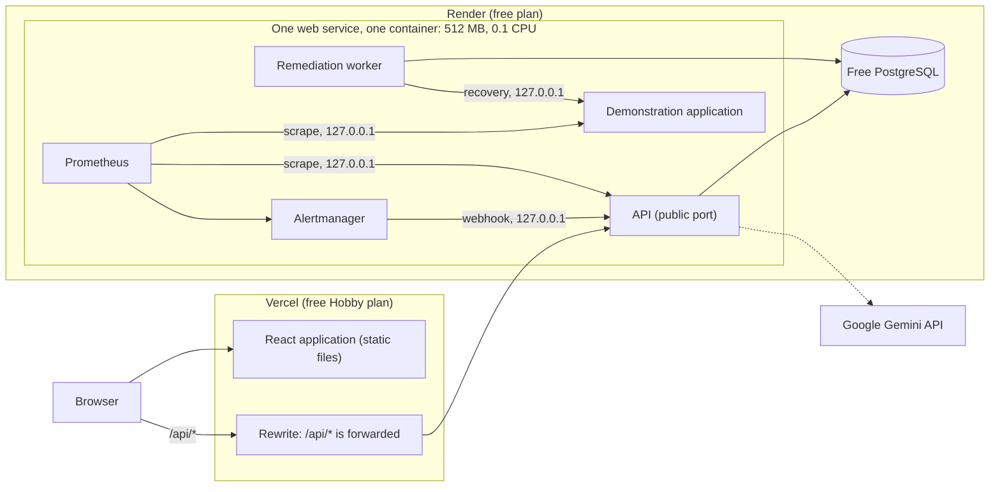

# Free hosting: Render (backend) and Vercel (frontend)

This is a second way to run VigilOps, for a public demonstration at no cost. The reference deployment is
still the Docker Compose stack ([`deployment.md`](deployment.md)); read the section "What is different
from the Compose stack" before relying on this one for anything but a demonstration.

Related: [Configuration](configuration.md) · [Security](security.md) · [Verification report](verification-report.md)

## How it is laid out



Why one container: Render's free plan offers web services and one PostgreSQL database, but no background
workers, no private services, no network between free services and no disks. The API and the worker must
share the scan workspace, and Prometheus must reach its targets, so everything except the database and
the frontend runs in a single web service:

| File | Purpose |
|---|---|
| [`render.yaml`](../render.yaml) | Render Blueprint: the web service, the database and every setting |
| [`deploy/render/Dockerfile`](../deploy/render/Dockerfile) | The single-container image |
| [`deploy/render/launcher.py`](../deploy/render/launcher.py) | Starts and supervises the five processes inside it |
| [`frontend/vercel.json`](../frontend/vercel.json) | Vercel build settings, the `/api` rewrite and the security headers |

Inside the container the components are still separated as far as one container allows:

- each runs as its own unprivileged user (`vigilops`, `vigilworker`, `demoapp`, `monitoring`);
- the scan workspace belongs to the worker; the API can read it through its group and cannot write it;
- each process receives only the environment variables it needs: the API never sees the recovery token,
  the worker never sees `SECRET_KEY`, the Gemini key or the webhook token, Prometheus and Alertmanager see
  no secret (Alertmanager reads the webhook token from a file only its user can read);
- the demonstration application, Prometheus and Alertmanager listen on `127.0.0.1` only. The API port is
  the only public port, and `/metrics` and `/health/ready` answer only the Prometheus process inside the
  container (`INTERNAL_ENDPOINTS_LOCAL_ONLY=true`).

This separation needs a host that lets the container start as root and switch users. If it does not,
the launcher runs every component as the one user it was given and writes a line starting with
`[launcher] WARNING` to the log; the platform works the same, without the per-user separation. Check the
first lines of the service log after the first deploy to see which case applies.

The monitoring configuration is not duplicated: the launcher uses `monitoring/prometheus.yml`,
`monitoring/alert_rules.yml` and `monitoring/alertmanager.yml` and only replaces the Compose host names
with `127.0.0.1`.

## What the free plans mean for you

| Fact (from the providers' documentation, read on 2026-11-23) | Consequence |
|---|---|
| A free Render web service is stopped after 15 minutes without incoming requests and takes about a minute to start again | The first visit after a pause is slow. The sign-in page says "The server is starting" and continues by itself. Open the site a few minutes before a demonstration |
| When it stops, its files are lost | Prometheus history, the Alertmanager state, an injected fault and any change to the sample configuration are gone after a pause. Incidents, findings, remediation requests, users and the audit trail are in PostgreSQL and stay |
| A free Render PostgreSQL database expires 30 days after it was created; 14 days later it is deleted. Only one free database per workspace | Plan the demonstration inside those 30 days, or see "When the database expires". If your Render workspace already has a free database, the Blueprint cannot create a second one |
| A free web service has 0.1 CPU and 512 MB | Sign-in takes several seconds (password hashing). The `cpu` and `memory` faults are switched off because the whole container would stall or be killed; `outage`, `errors` and `latency` work |
| 750 free instance hours per workspace and month, shared by all free services | Enough for one service that is always awake; less if other free services run in the same workspace |
| Vercel waits up to 120 seconds for the backend when it forwards a request | Long enough for the backend to wake up |

Nothing here requires a payment method, and nothing in this repository enables billing. If a provider asks
for a card or shows a price, stop: that is not this setup.

## Steps

You need a Render account and a Vercel account, both connected to the GitHub account that owns the
repository.

### 1. Backend on Render

1. Open the deploy link below, or in the Render Dashboard choose **New** and then **Blueprint** and
   select the `VigilOps` repository. Render reads `render.yaml` and lists one web service (`vigilops`)
   and one database (`vigilops-db`).

   [](https://render.com/deploy?repo=https://github.com/Gangadhar017/VigilOps)
2. Render asks for three values. They are typed here and stored only by Render:

   | Variable | What to enter |
   |---|---|
   | `BOOTSTRAP_ADMIN_PASSWORD` | Password of the first Administrator (`admin@vigilops.local`). At least 10 characters with an upper-case letter, a lower-case letter and a digit |
   | `BOOTSTRAP_OPERATOR_PASSWORD` | Password of the first Operator (`operator@vigilops.local`). Same rule; use a different one |
   | `GEMINI_API_KEY` | Your Google Gemini API key. Without one VigilAI works in documentation mode |

   If a password does not meet the rule the service refuses to start and the deploy log says which
   variable is wrong.
3. Apply the Blueprint. The first build takes several minutes. When the service is **Live**, open
   `https://<service>.onrender.com/api/health`; it must show `{"status":"healthy"}`.
4. Note the address. `render.yaml` names the service `vigilops`, so it is `https://vigilops.onrender.com`
   if that name was still free; otherwise Render appends a suffix.

All other secrets (`SECRET_KEY`, the webhook token, the two demo-application tokens) are generated by
Render. The region is `singapore` for both the service and the database; they must be the same, and a
region cannot be changed after creation, so edit `render.yaml` first if you want another one.

### 2. Frontend on Vercel

1. If the Render address is not `https://vigilops.onrender.com`, change the `destination` of the first
   rewrite in `frontend/vercel.json` to your address and push the change.
2. In Vercel choose **Add New**, **Project**, and import the `VigilOps` repository.
3. Set **Root Directory** to `frontend`. The other settings come from `frontend/vercel.json` (build
   command `npm run build`, output directory `dist`). No environment variables are needed.
4. Deploy. Open the address Vercel shows and sign in with `admin@vigilops.local` and the password you chose.

The browser talks only to the Vercel address; Vercel forwards `/api/*` to Render. The frontend therefore
needs no backend address at build time and the backend needs no CORS setting.

### 3. Check

- Sign in as Administrator; the Overview shows both monitored resources as UP after a few seconds.
- Settings, tab Demo controls: `outage`, `errors` and `latency` are offered.
- Run the two demonstrations from the [demonstration script](college/demo-script.md).
- From a computer with Python you can run the scripted demonstrations against the hosted instance. They
  read the accounts from a local `.env`, so the passwords there must be the ones you entered on Render:

  ```bash
  python scripts/run_e2e_demos.py --base-url https://<your-app>.vercel.app --no-save
  ```

## Updating

Both platforms redeploy automatically on every push to `main`. A redeploy restarts the container, which
has the same effect as a pause (see the table above). The three values you typed on Render are kept;
to change one, edit it under the service's **Environment** tab. The bootstrap passwords only create the
accounts on first start: after that, change a password inside VigilOps (Settings, tab Profile).

## When the database expires

Render sends an e-mail before the free database expires. To continue for free, delete the expired
database and sync the Blueprint again (Render Dashboard, **Blueprints**, your Blueprint, **Manual
Sync**): the database declared in `render.yaml` is then created anew and connected to the service. This
path could not be tried while writing this guide, because a database has to expire first. If the sync
does not create it, create a free PostgreSQL yourself in the same region and set the service's
`DATABASE_URL` to its internal connection string.

On the next start the service creates the schema and the two bootstrap accounts again. The earlier
incidents, findings and audit trail are gone; there are no backups on the free plan. Any PostgreSQL 16
database reachable from Render can be used instead by setting `DATABASE_URL`.

## What is different from the Compose stack

| Topic | Compose stack | This deployment |
|---|---|---|
| Isolation between components | One container each; read-only root file systems; no Linux capabilities; the workspace is mounted read-only into the API container | One container; separation by Unix users, file permissions and per-process environment. A flaw that gives code execution in one component is closer to the others than with separate containers |
| Public surface | Only Caddy; it forwards `/api/*` only | The API port itself. `/metrics` and `/health/ready` are refused for outside callers by the API; `/health/live` and `/api/health` answer with a status only |
| Client address | Set by the trusted reverse proxy | Taken from a forwarding header that an outside caller can forge. Sign-in is therefore also limited per e-mail address; the address recorded in the audit trail is not reliable |
| Demo controls | Off in production mode | On, by the explicit setting `ALLOW_DEMO_CONTROLS_IN_PRODUCTION`, because the instance exists to demonstrate. Still Administrator-only and audited |
| Fault modes | All five | `cpu` and `memory` switched off (`DEMO_DISABLED_FAULTS`) |
| Monitoring history | Kept in a volume for 7 days | Lost at every pause or redeploy |
| Database | Your own PostgreSQL volume, with backup scripts | Free managed database, 30 days, no backups |
| Synthetic load | Two requests per second | One request per second |

Use it to show the project. Do not point it at a real workload.

## Troubleshooting

| Symptom | Cause and fix |
|---|---|
| The deploy fails and the log says a `BOOTSTRAP_..._PASSWORD` does not meet the password policy | Change the value under Environment (10 or more characters, upper case, lower case, a digit) and deploy again |
| The Blueprint cannot create the database | The workspace already has a free database. Delete the old one, or remove the `databases` block from `render.yaml` and set `DATABASE_URL` yourself |
| The site shows "The server is starting" for about a minute | The service was asleep. This is expected on the free plan |
| "The server is not answering" after three minutes | Open the service in the Render Dashboard: is it Live, did the last deploy fail, has the month's free hours run out? |
| Sign-in works on the Render address but the Vercel site cannot reach the API | The `destination` in `frontend/vercel.json` does not match the Render address, or Root Directory is not `frontend` |
| An incident stays OPEN after a pause | The fault disappeared with the restart and Alertmanager's memory of the alert with it, so no "resolved" notification arrives. Resolve the incident manually; the platform checks with Prometheus that the alert is no longer firing |
| VigilAI answers with a notice about credentials or the model | The `GEMINI_API_KEY` or `GEMINI_MODEL` value on Render is wrong; correct it under Environment |
| The log shows a component being restarted repeatedly, then the service restarts | One of the five processes keeps exiting; the lines before it in the log say which and why |

## What was verified, and what was not

See section 8 of the [verification report](verification-report.md). In short: the image was built and
run locally with the same limits as Render's free plan and passed the three demonstrations there, and a
CI job repeats that on every push. The deployment on Render and Vercel themselves has to be created from
your accounts; its status is recorded in the same section.
