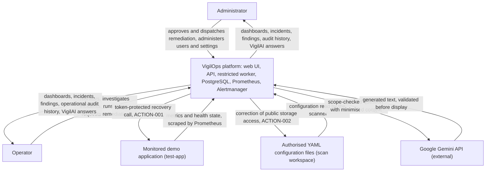

# System Context Diagram

VigilOps sits between its two kinds of users, the workload it monitors and one external service. The Google Gemini API is the only dependency outside the deployment, it is called only by the backend, and the platform keeps working (documentation fallback) when it is not configured or not reachable.

The scanner reads local files only: VigilOps is not connected to a cloud provider account.
