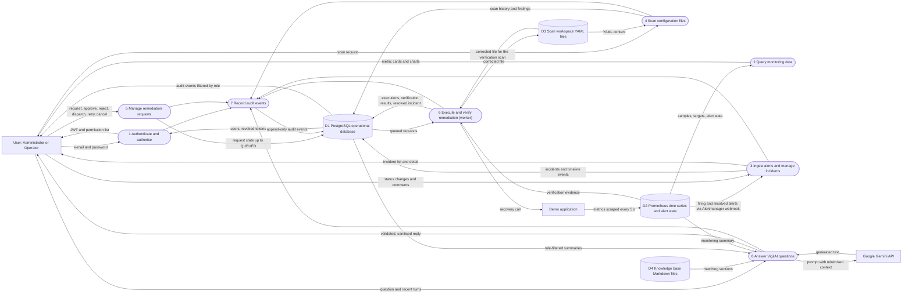

# Data Flow Diagram (Level 1)

The diagram shows the eight main processes, the four data stores and the external entities. Every state-changing process writes its audit events through the same process (7) into the operational database, in the same transaction as the change itself.

