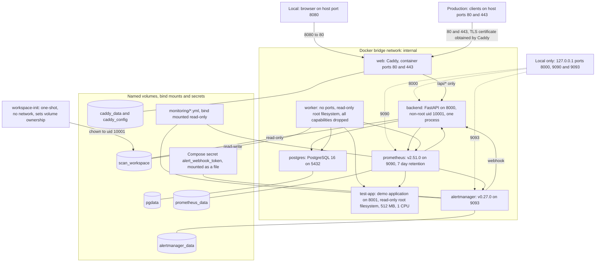

# Deployment Diagram

All long-running containers share one Docker bridge network (`internal`); the difference between the local stack (`compose.yaml`) and production (`compose.yaml` plus `compose.prod.yaml`) is which host ports are published. Locally the web application is published on port 8080 and three tool ports are bound to 127.0.0.1 only; the production overlay publishes nothing but 80 and 443 on `web`.

In production the overlay also sets `ENVIRONMENT=production` on the backend and the worker and forces `DEMO_CONTROLS_ENABLED=false` on the backend, the worker and the demo application. Step-by-step instructions are in [../deployment.md](../deployment.md).
