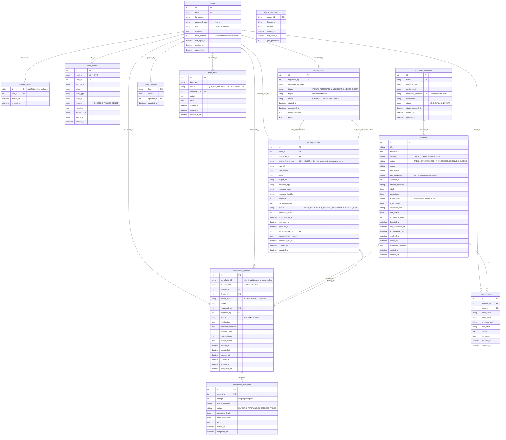

# Entity-Relationship Diagram

The diagram lists the thirteen tables defined in `backend/app/models/models.py` (created by the Alembic migration `0001_initial_schema.py`) with their main columns. `worker_heartbeats` has no foreign keys; all timestamps are timezone-aware UTC, and the JSON column shown as `metadata` is mapped to the Python attribute `event_metadata`.

Constraints that the diagram cannot express (partial unique indexes, CHECK constraints, the append-only trigger on `audit_events`) are described in [../architecture.md](../architecture.md#database-design).
