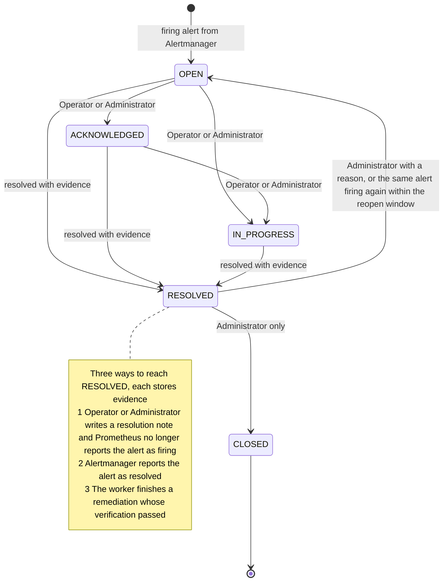

# Incident Lifecycle

The transitions are exactly those of `TRANSITIONS` in `backend/app/services/incident_service.py`; any other move is rejected with HTTP 409. Acknowledging, starting work and resolving need the permission `incidents:update` (Operator and Administrator), while closing and reopening need `incidents:close` (Administrator only).

Additional rules enforced by the code:

- A manual resolution needs a note of at least 10 characters. If Prometheus still reports the alert as firing, or cannot be reached, the request is refused with HTTP 409. Only in the second case (Prometheus cannot be reached) can an Administrator set `override_monitoring`; the override is stored in the evidence.
- Reopening by an Administrator needs a reason of at least 10 characters.
- The automatic reopen applies only to RESOLVED incidents whose resolution is younger than the runtime setting `incidents.reopen_window_minutes` (default 10, 0 disables it). CLOSED incidents are never reopened; a new incident is created instead.
- A partial unique index allows at most one incident per alert fingerprint in the three active states (OPEN, ACKNOWLEDGED, IN_PROGRESS).
