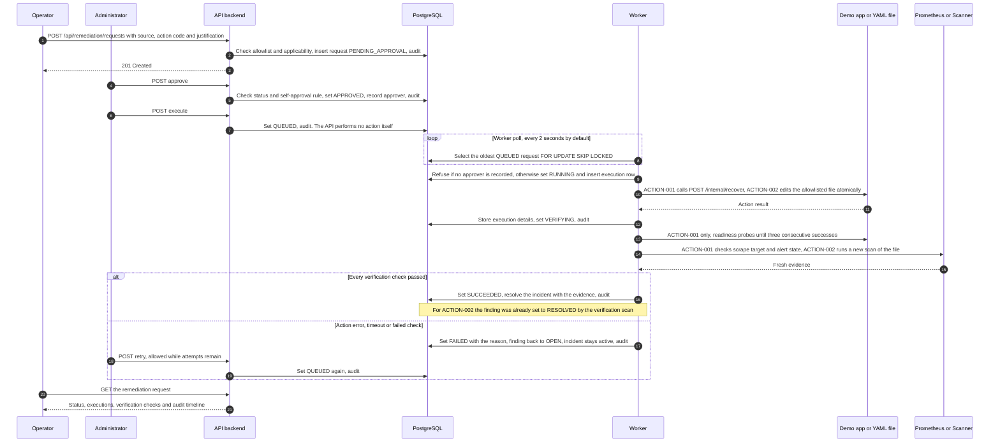

# Remediation Sequence

The API only records decisions and moves a request to QUEUED; the corrective action and its verification happen in the restricted worker, which claims queued rows from PostgreSQL. A request is SUCCEEDED only when verification with fresh evidence passes, otherwise it is FAILED and the underlying problem is treated as not fixed.

Requests can also end as REJECTED (Administrator, with a reason) or CANCELLED (the requester or an Administrator, before dispatch); neither path reaches the worker.
