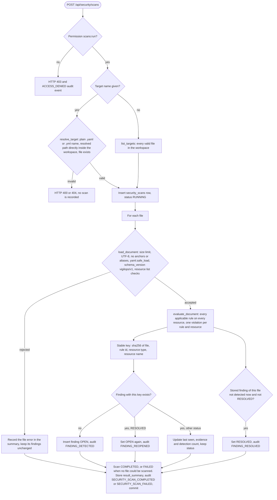

# Security Scanning Flow

A scan evaluates authorised YAML files from the scan workspace against rules SEC-001 to SEC-005 and then reconciles the result with the stored findings: new violations create findings, known ones are updated, returning ones are reopened and violations that disappeared are resolved. A file that fails validation is reported in the scan summary and its existing findings are left untouched.

The same `run_scan` function is used by the worker to verify ACTION-002 (trigger `REMEDIATION_VERIFICATION`) and by the demo reset (trigger `DEMO_RESET`).
