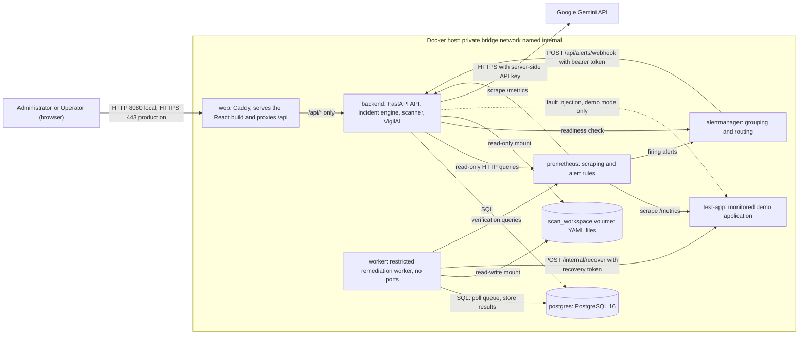

# System Architecture

VigilOps runs as eight Docker Compose services on one private bridge network; `web` (Caddy) is the only service meant to be reached by users, and it forwards nothing but `/api/*` to the backend. The restricted worker has no inbound port: it only polls PostgreSQL for dispatched remediation requests and is the only writer of the scan workspace volume.

Not shown: the one-shot `workspace-init` container (it only sets the ownership of the `scan_workspace` volume and then exits, see [deployment.md](deployment.md)), and Prometheus scraping itself and Alertmanager.
