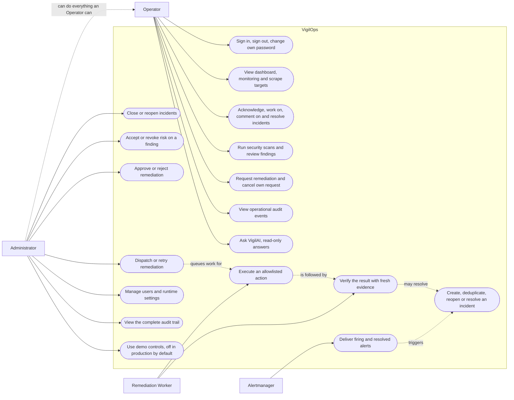

# Use Case Diagram

The use cases follow the permission matrix in `backend/app/core/permissions.py`: an Administrator can do everything an Operator can, plus the approval, closing, administration and demo-control use cases. Alertmanager and the Remediation Worker are system actors: the first feeds the incident engine through the protected webhook, the second executes and verifies only what an Administrator approved and dispatched.

