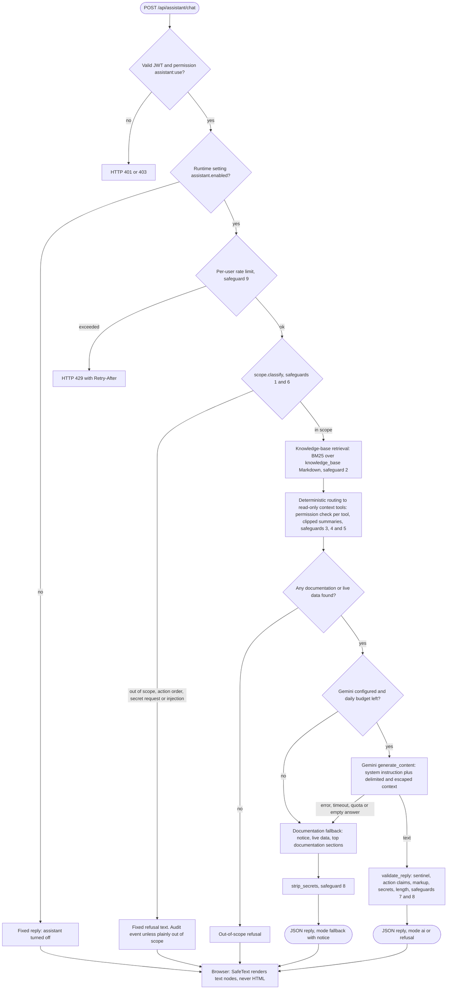

# VigilAI Architecture

VigilAI is a pipeline in `backend/app/assistant/service.py` in which the language model is only one step: scope validation, retrieval, live-data access and output checks are ordinary backend code that does not depend on the model following its instructions. When Gemini is not configured or a call fails, the same documentation and live data are returned directly (documentation fallback). Live Gemini generation was verified on 2026-11-23 with a real API key and the default model `gemini-3.5-flash-lite` by `scripts/verify_gemini_live.py` (evidence in [`../evidence/gemini-live.json`](../evidence/gemini-live.json)); real quota exhaustion (HTTP 429 from the provider) was not observed.

The numbered safeguards are mapped to modules and functions in [../security.md](../security.md#vigilai-safeguards).
