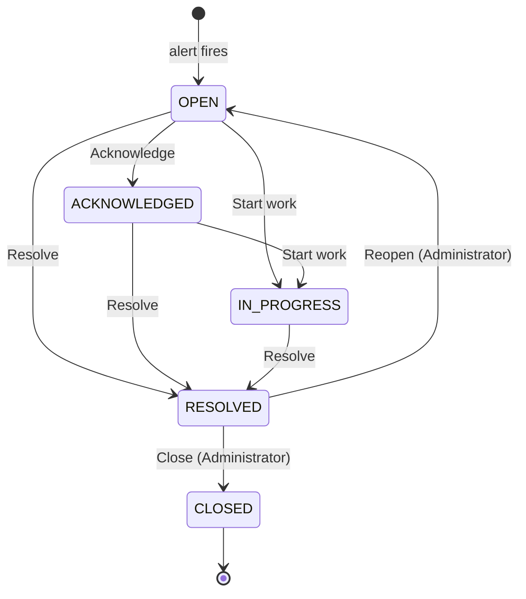

# User Guide

How to use VigilOps as an Administrator and as an Operator: every page, the incident lifecycle, the
remediation workflow, finding states, and what the badges mean. Button, tab and column names are
written as they appear in the interface.

Related documents: [setup](setup.md), [configuration](configuration.md),
[troubleshooting](troubleshooting.md), [security](security.md).

## Contents

1. [Signing in and the layout](#signing-in-and-the-layout)
2. [Roles at a glance](#roles-at-a-glance)
3. [Overview](#overview)
4. [Monitoring](#monitoring)
5. [Incidents](#incidents)
6. [Security Findings](#security-findings)
7. [Remediation](#remediation)
8. [Audit Logs](#audit-logs)
9. [VigilAI / Help](#vigilai--help)
10. [Settings](#settings)
11. [Badges and labels](#badges-and-labels)

## Signing in and the layout

Open the web application (locally <http://localhost:8080>) and sign in with your e-mail and password.
Accounts are created by an Administrator; there is no self-registration. The first two accounts come
from the `.env` file (see [setup](setup.md#signing-in-with-the-bootstrap-accounts)).

- Any invalid combination gives the same message, "Incorrect e-mail or password."
- After five failed attempts for the same e-mail from the same address within five minutes, further
  attempts are refused until the window has passed.
- A session lasts 60 minutes by default. It is stored per browser tab and ends when the tab is
  closed, when you choose **Logout**, or when your password or role is changed. You are then
  returned to the sign-in page with "Your session has ended. Please sign in again."

After signing in:

| Area | Content |
|---|---|
| Sidebar | Overview, Monitoring, Incidents, Security Findings, Remediation, Audit Logs, VigilAI / Help, Settings. A counter next to Incidents shows active incidents; a counter next to Remediation shows requests waiting for approval. Your name, e-mail and role are at the bottom with the **Logout** button. |
| Header | The environment (for example DEVELOPMENT), the badge "Demo controls enabled" when the demonstration controls are active on the server, your role, and a light/dark theme switch. |
| Bottom-right corner | The round VigilAI button, on every page. |

Pages refresh their data automatically every few seconds while the browser tab is visible, and each
page has a **Refresh** button. Times are shown in your local time zone; hover over a time to see it
in UTC.

## Roles at a glance

| Page | Administrator | Operator |
|---|---|---|
| Overview, Monitoring | View | View |
| Incidents | View, Acknowledge, Start work, Resolve, add notes, **Close**, **Reopen** | View, Acknowledge, Start work, Resolve, add notes |
| Security Findings | View, Run scan, request remediation, **Accept risk**, **Revoke risk acceptance** | View, Run scan, request remediation |
| Remediation | View, request, **Approve**, **Reject**, **Execute**, **Retry**, cancel any pending request | View, request, cancel own pending requests |
| Audit Logs | All events | Operational events and own activity |
| VigilAI / Help | Use | Use |
| Settings | Profile, **Users**, Platform (can change runtime settings), Permissions, **Demo controls** | Profile, Platform (read-only), Permissions, Demo controls (view only) |

The interface hides or disables what your role cannot do, but the decision is always made by the
backend. A refused action returns an error message and is written to the audit trail.

## Overview

The landing page. It is the same for both roles.

- **Four summary cards.** "Active incidents", "Open security findings", "Pending approvals" and
  "Remediation results" (succeeded and failed). Each card opens the corresponding page with a
  matching filter. The numbers are counted from stored records.
- **Notice about simulated incidents.** If active incidents were opened by a controlled
  demonstration fault, a banner says so.
- **Monitored resources.** One card per resource (`demo-app`, `vigilops-backend`) with its status
  (Up, Down or Unknown), the tag "Live · Prometheus" with the time of the query, and request rate,
  5xx and 4xx error rate, p95 latency, CPU, memory and uptime. A value Prometheus cannot provide is
  shown as "Unavailable"; hover to see the reason.
- **Two charts** for the demo application: HTTP request rate and HTTP 5xx error rate over the last
  15 minutes, the latter with the alert threshold line at 20%.
- **Active incidents by severity** and **Unresolved findings by severity** (open or with
  remediation pending).
- **Platform health.** Backend API, Database, Prometheus, Alertmanager, Monitoring targets
  ("n of m up") and Remediation worker, each Healthy, Unavailable or Unknown.
- **Latest security scan** with status, time, who requested it and its result.
- **Recent audit events.** The latest eight events you are allowed to see.

If Prometheus cannot be reached, a notice states that live metrics cannot be shown; no values are
estimated.

## Monitoring

Live telemetry read from Prometheus by the backend. The page is the same for both roles.

**Top line.** "Live · Prometheus" with the time of the last query, the scrape interval, and whether
Prometheus and Alertmanager are available.

**Resource and time range.** Choose the resource (`demo-app` or `vigilops-backend`) with the buttons
on the left, and the chart range with **5 min**, **15 min**, **1 hour** or **6 hours** on the right.

**Metric cards.**

| Card | Meaning |
|---|---|
| Availability | Whether Prometheus could scrape the target (Up or Down) |
| HTTP request rate | Requests per second over the last minute |
| HTTP 5xx error rate | Share of responses with a 5xx status over the last minute |
| HTTP 4xx error rate | Share of responses with a 4xx status over the last minute |
| Response latency (p95) | 95th percentile request duration over the last minute |
| CPU usage | Process CPU time per second, as a percentage of one core |
| Memory (resident) | Resident memory of the process |
| Uptime | Time since the process started |

A card shows "Unavailable" with the reason from Prometheus when there is no value.

**Charts.** Request rate, 5xx error rate, 4xx error rate, p95 latency, CPU and memory for the
selected range. For the demo application the charts include the alert thresholds as dashed lines
(20%, 1 s, 80%, 250 MiB). Periods without samples, for example while the target was down, are drawn
as gaps.

**Scrape targets.** Every Prometheus target with Job, Instance, Health and Last scrape. A target that
is down shows the scrape error underneath. The badge "Stale" means the target has not been scraped
recently, so its health may be outdated.

**Alert rules currently active.** Alerts that Prometheus currently reports as Pending (condition
true, waiting for the rule's duration) or Firing, with severity and start time. When nothing is
listed, all rules are inactive.

The demo application receives synthetic traffic from a built-in load generator, so its request
metrics always have data. The values are real measurements of that traffic.

## Incidents

Incidents are opened automatically when Alertmanager delivers a firing alert. Nobody creates them by
hand.

### The list

Columns: ID (`INC-<number>`), Incident (title, alert name and badges), Severity, Status, Resource,
Detected, Last occurrence, Notifications.

- **Search** by title, alert, resource or ID.
- Filter by **Status** and **Severity**, or tick **Active only** to see incidents that are Open,
  Acknowledged or In Progress.
- Select a column heading to sort. Select a row to open the incident.

"Notifications" counts how many times Alertmanager has reported the alert for this incident. Repeated
notifications for the same alert update the existing incident; they never create a duplicate.

### The incident page

The heading shows the status, the severity, "Alert firing" or "Alert cleared", and where applicable
"Simulated fault" and "Signal stale". The buttons on the right are the transitions you are allowed to
make.

| Section | Content |
|---|---|
| Details | Description, affected resource, source and alert name, alert fingerprint, detection time, latest occurrence with the notification count, acknowledgement and resolution times, and the resolution text. |
| Recommendation | What the problem is, possible causes, recommended steps and troubleshooting notes from the built-in runbook for this alert, followed by the automated remediation panel. |
| Timeline | Every event: alert received, repeated, status changes, remediation steps, notes. Use "Add a note to the timeline" and **Add note** to record what you checked. |
| Linked remediation | Remediation requests for this incident with their status. |
| Alert labels | The labels of the Prometheus alert. |

The automated remediation panel shows **Request remediation** when ACTION-001 applies, which is the
case for active incidents on the demo application. Otherwise it explains why no automated action is
available and you follow the recommended steps manually.

### Incident lifecycle

| Button | From | To | Who | Requirement |
|---|---|---|---|---|
| Acknowledge | Open | Acknowledged | Both roles | Note optional |
| Start work | Open, Acknowledged | In Progress | Both roles | Note optional |
| Resolve | Open, Acknowledged, In Progress | Resolved | Both roles | Resolution evidence of at least 10 characters; monitoring must no longer report the alert as firing |
| Close | Resolved | Closed | Administrator | Note optional; Closed is final |
| Reopen | Resolved | Open | Administrator | Reason of at least 10 characters |

Any other change is rejected.

**Resolving requires evidence.** An incident is never resolved because remediation was merely
requested. It becomes Resolved in one of three ways:

1. Alertmanager reports that the alert has cleared. The incident is resolved automatically with the
   text "Resolved automatically: monitoring reported that the alert condition cleared."
2. A remediation request for the incident succeeds after verification. The verification checks are
   stored as evidence.
3. A person chooses **Resolve** and describes how recovery was verified. If the alert is still
   recorded as firing, the backend asks Prometheus. The request is refused while Prometheus reports
   the alert as firing, and also when Prometheus cannot be reached.

**Administrator override.** In the Resolve dialog an Administrator sees a checkbox "Administrator
override" while the alert is recorded as firing. It applies only when Prometheus cannot be asked
(monitoring is unavailable): the incident is then resolved on the Administrator's word, and the
override and the evidence text are recorded in the audit trail. It does not work while Prometheus
positively reports the alert as firing; that request is refused for every role. If the alert fires
again later, the next notification reopens the incident.

**What happens automatically.**

- If the same alert fires again within the reopen window (10 minutes by default, a runtime setting)
  after an incident was resolved, that incident is reopened instead of a new one being created.
  Closed incidents are never reopened.
- When an incident is resolved by the monitoring signal or by a person, remediation requests for it
  that were not yet dispatched are cancelled.

## Security Findings

Results of the configuration scanner. The scanner evaluates the YAML files in the scan workspace
against rules SEC-001 to SEC-005. It does not assess a live cloud account. How to add files and how
they must be written is described in [configuration](configuration.md#the-scan-workspace).

**Run scan** (both roles) scans every file in the workspace. A banner then shows how many files were
scanned and how many violations were found, new, reopened and resolved.

### Tabs

| Tab | Content |
|---|---|
| Findings | One row per finding: Rule, Finding (rule name and evidence summary), Severity, Status, Affected resource (type/name and file), Last seen. Search by rule, resource or file; filter by Status, Severity and Rule. |
| Scan history | Every scan with Status, Trigger (Manual, Demo Reset or Remediation Verification), who requested it, Target, Result and completion time. Files that could not be read are listed with the reason. |
| Rules | The five rules with severity, description, detection logic, security impact, corrective action and the resource types they apply to. A rule is marked "Automated: ACTION-002" or "Manual fix". |
| Configuration files | The files that may be scanned, with size, modification time and whether automated remediation is allowed ("Allowlisted" or "Read-only"). **View** shows the file content. |

### The finding page

| Section | Content |
|---|---|
| What was detected | The problem, the affected resource, the evidence, the detection logic, the security impact, when it was first detected and last seen, and the raw evidence. |
| How to fix it | The recommendation and numbered manual steps. For an Open finding it also contains the automated remediation panel. |
| Remediation requests | Requests made for this finding. |
| History | Detection, reopening, resolution, risk acceptance and remediation events. |
| Rule | Identifier, name, severity and resource types. |

Automated remediation exists only for SEC-001, and only when the file is on the remediation
allowlist. For the other rules the panel says so and you apply the listed steps to the file yourself
and run a scan.

### Finding states

| State | Meaning | How it is entered | How it is left |
|---|---|---|---|
| Open | Detected and not addressed | A scan detects the violation, or it returns after having been resolved | Remediation is requested, risk is accepted, or a scan no longer detects it |
| Remediation Pending | A remediation request is in progress | **Request remediation** is submitted | Back to Open if the request is rejected, cancelled or fails; Resolved by the verification scan |
| Resolved | A later scan no longer detects the violation | Only by a scan | Reopens automatically if the violation is detected again |
| Accepted Risk | An Administrator decided not to fix it and recorded why | **Accept risk** on an Open finding, justification of at least 10 characters | **Revoke risk acceptance** returns it to Open; a scan that no longer detects it resolves it |

Findings are never deleted. A finding is resolved by a scan, not by hand: fixing the file manually and
choosing **Run scan** has the same effect as the automated action.

## Remediation

Controlled remediation of the two supported actions.

| Action | Applies to | What the worker does | How success is verified |
|---|---|---|---|
| ACTION-001 Recover monitored demonstration application | Active incidents on the demo application | Calls the demo application's token-protected recovery endpoint, which re-initialises its service component and clears a fault | Three consecutive successful readiness checks; Prometheus has scraped the target successfully after the action; the alert that opened the incident is no longer firing |
| ACTION-002 Correct public storage configuration | Open SEC-001 findings in an allowlisted file | Sets `public_access: false` and `acl: private` for the bucket, writes the file and records a before/after diff | A new scan of the file completes; SEC-001 is no longer detected for the bucket; the finding has been resolved by that scan |

ACTION-001 cannot start a stopped container. The platform has no access to Docker or the host.

### The list

Columns: Request, Action (with the target), Status, Source (incident or finding), Requested by,
Decided by, Requested. Search by target, action or `#id`; filter by **Status**; tick **My requests**
to see only your own.

The side panel shows the **Restricted worker** (Online or Offline, last heartbeat, jobs processed)
and the **Supported actions (allowlist)**. If the worker is offline, a warning explains that
dispatched requests stay queued.

### The workflow

| Step | Who | In the interface | Resulting status |
|---|---|---|---|
| 1. Request | Operator or Administrator | On the incident or finding: **Request remediation**, enter a justification of at least 10 characters, **Submit request** | Pending Approval |
| 2. Decide | Administrator | On the request page: **Approve** (comment optional) or **Reject** (reason required) | Approved or Rejected |
| 3. Dispatch | Administrator | **Execute** | Queued |
| 4. Execute | Worker | Automatic | Running |
| 5. Verify | Worker | Automatic | Verifying, then Succeeded or Failed |

Rules that the backend enforces:

- Only the two allowlisted action codes can be requested. A request cannot contain a command, a
  script or a path.
- One incident or finding can have only one request in progress at a time.
- Approving does not execute anything. Execution starts only after **Execute**, and the worker
  refuses a queued request that has no recorded approval.
- By default an Administrator cannot approve a request they submitted. The request page then shows
  that it is waiting for another Administrator. This can be changed with the runtime setting
  "Allow self-approval of remediation".
- **Cancel request** is available to the requester and to Administrators while the request is
  Pending Approval or Approved.
- A request succeeds only if verification passes. If the action or the verification fails, the
  request is Failed, the finding returns to Open and the incident stays as it was.
- **Retry** (Administrator) queues a Failed request again under its existing approval, up to three
  attempts in total. After that a new request is needed.

| Status | Meaning |
|---|---|
| Pending Approval | Waiting for an Administrator's decision |
| Approved | Approved, not yet dispatched |
| Rejected | Declined by an Administrator; final |
| Queued | Dispatched, waiting for the worker |
| Running | The worker is executing the action |
| Verifying | The action ran; the worker is collecting evidence |
| Succeeded | Executed and verified; final |
| Failed | Execution or verification failed; can be retried within the attempt limit |
| Cancelled | Withdrawn before dispatch, or cancelled because the incident was resolved first; final |

### The request page

- A progress line from Pending Approval to Succeeded, and the buttons you may use.
- **Request**: source (with a link), target, justification, who requested and who decided, attempts
  used, and the Correlation ID. Selecting the Correlation ID opens Audit Logs filtered to this
  workflow.
- **Execution and verification**: one block per attempt with what was done. For ACTION-002 this
  includes the changed values and the configuration diff; for ACTION-001 the health before the
  action and the recovery calls. Below it, each verification check with its result and time.
- **Action definition** and the **Audit trail** of the request.

## Audit Logs

An append-only history of important events. Nothing in the application can edit or delete it.

- **Search** across action, actor, resource and metadata.
- Filter by **Category** (Authentication, Incidents, Security scans, Findings, Remediation, User
  administration, Settings, Access denied, VigilAI, Demo controls), by **Outcome** (Success, Failure,
  Denied) and by date with **From** and **To**.
- Columns: Time, Actor, Action, Resource, Outcome, Correlation. Select a row to see the event ID, the
  UTC timestamp, the source address and the metadata.
- All events of one remediation workflow share a correlation ID. Opening Audit Logs from a
  remediation request shows only that workflow; **Clear** removes the filter.

The actor is a user's e-mail or a service identity: `alertmanager` for alert-driven events, the
worker's identifier for execution and verification, `system` for automatic actions.

| Role | Sees |
|---|---|
| Administrator | Every event, including sign-ins, user administration and settings changes |
| Operator | Operational events (incidents, scans, findings, remediation, demonstration controls) and events of their own account |

The notice at the top of the page states which of the two applies to you.

## VigilAI / Help

VigilAI is a read-only assistant for questions about VigilOps.

### The chat widget

Select the round button at the bottom-right of any page.

- The panel opens with a welcome message and suggested questions. Type in "Ask about VigilOps…";
  Enter sends, Shift+Enter starts a new line, Escape closes the panel.
- The line under the name shows the mode: "Gemini" when live AI generation is configured,
  "Documentation mode" otherwise.
- Under an answer, tags show what it was based on: "Live platform data" when current platform data
  was used, and the documentation sections consulted. A refusal is tagged "Declined".
- In documentation mode, and whenever the AI provider cannot be used, the answer starts with a notice
  explaining why and then gives the matching documentation and live data directly.
- The bin icon clears the conversation. The conversation is kept in the browser's memory only; it is
  lost when the page is reloaded or you sign out.
- A message can be up to 1000 characters, and each user can send 10 messages per minute by default.
- A short follow-up such as "how do I fix it?" is understood in the context of your last platform
  question for 15 minutes.

What it can answer: explanations of monitoring, alerts, incidents, the five security rules,
remediation, roles, audit logs, architecture and configuration; the current open incidents,
unresolved findings, remediation requests, monitoring status, latest scan and recent audit events,
limited to what your role may see; troubleshooting steps.

What it will not do, by design:

| Request | Response |
|---|---|
| Anything unrelated to VigilOps, such as general knowledge, jokes or poems | A fixed reply asking for a VigilOps question |
| An instruction to act, such as approving remediation, running a scan or changing a user | Declined; it explains the workflow a person must follow |
| A request for credentials, keys or tokens | Declined |
| An attempt to change its rules or role | Declined |

These checks are made by the backend before any model is called. Requests in the last three groups
are recorded in the audit trail. Because the scope check is keyword based, a platform question with
unusual wording can be declined; rephrase it with platform terms such as incident, finding or
remediation.

### The VigilAI / Help page

- The current mode: "Live AI: Google Gemini", "Documentation mode" or "Disabled".
- **Open VigilAI**, and a "Try asking" list whose **Ask** links send the question to the widget.
- What VigilAI can and cannot do, the safeguards, and the knowledge base topics.
- **Guided workflows**: the steps of the two main demonstrations with links to the pages involved.

## Settings

The tabs depend on your role.

### Profile

Your name, e-mail, role and last sign-in, and **Change password**. The new password needs at least
10 characters with upper-case and lower-case letters and a digit, and must differ from the current
one. Changing it signs out all of your sessions, including the current one. After five wrong entries
of the current password, further attempts are refused for up to five minutes.

### Users (Administrator)

| Task | How |
|---|---|
| Create a user | **Add user**: e-mail, full name, role, initial password, then **Create user** |
| Change a role | The Role selector in the user's row |
| Reset a password | **Reset password**, enter a new password |
| Deactivate or reactivate | **Deactivate** or **Reactivate** in the user's row |

- The last active Administrator cannot be demoted or deactivated, and you cannot deactivate your own
  account.
- Changing a role, deactivating a user or resetting a password signs out that user's sessions.
- Users are not deleted; a deactivated account cannot sign in.

### Platform

- **Runtime settings**: "Allow self-approval of remediation", "Incident reopen window (minutes)" and
  "VigilAI assistant enabled". An Administrator changes a switch directly or enters a number and
  chooses **Save**. Operators see the values read-only. See
  [configuration](configuration.md#runtime-settings).
- **System**: version, environment, whether demonstration controls are enabled, session length,
  login rate limit, and whether the API documentation is enabled. A warning appears while the
  placeholder secrets from `.env.example` are in use.
- **VigilAI**: provider, model, whether an API key is configured (the key is never shown), rate
  limits and timeout.
- **Security scanner**: scope, maximum file size and the remediation allowlist.
- **Remediation**: worker status, maximum attempts and timeouts.

Apart from the runtime settings, these values come from the server's environment and are changed in
`.env`.

### Permissions

The role permission matrix as the backend enforces it.

### Demo controls

Available only when the server runs outside production mode with `DEMO_CONTROLS_ENABLED=true`;
otherwise the tab states that the controls are disabled. Operators can open the tab but cannot use
the buttons, and the demo application's fault state is reported to Administrators only (an Operator
sees a notice instead of the status badge).

**Controlled faults on the demo application.** Choose **Inject** next to a fault and confirm with
**Inject fault**.

| Fault | Effect on the demo application | Alert rule that watches this condition |
|---|---|---|
| outage | Every service endpoint and `/metrics` answer HTTP 503 | ApplicationUnavailable |
| errors | The business endpoint answers HTTP 500 for most requests | HighHttp5xxErrorRate |
| latency | The business endpoint takes about 1.5 seconds | HighApiLatency |
| cpu | A background thread keeps one core busy | HighCpuUsage |
| memory | The service allocates a block of memory | HighMemoryUsage |

For an Administrator the badge at the top of the card shows "No fault active", "Active fault:" with
the fault's name, or "Demo app unreachable" when the demo application does not answer. The cpu and memory faults clear themselves after ten minutes. **Clear fault** returns
the application to normal immediately, without the approval workflow; to demonstrate remediation,
recover through an incident with ACTION-001 instead.

**Sample cloud configuration.** **Reset sample configuration** makes the worker restore
`cloud-infrastructure.yaml` to its insecure baseline and runs a scan. Existing findings are kept and
reopen.

Every use of these controls is recorded in the audit trail.

## Badges and labels

| Badge or label | Where | Meaning |
|---|---|---|
| Simulated fault | Incident list and incident page | The incident was opened while a controlled demonstration fault was active on the demo application. The alert and the telemetry are real; the cause was injected deliberately. The badge is set when the incident is created and stays. |
| Signal stale | Incident list and incident page | The incident is active and its alert is recorded as firing, but Alertmanager has not repeated the notification for more than seven minutes (three repeat intervals plus one minute, with the default configuration). The monitoring pipeline may be unhealthy; check Prometheus and Alertmanager on the Monitoring page. |
| Live · Prometheus | Overview resource cards, Monitoring | The values were queried from Prometheus by the backend at the time shown next to the label. |
| Unavailable | Metric cards and values | Prometheus returned no value for this metric: Prometheus is unreachable, the target is down, or there is no data yet. The reason is shown on the card or on hover. A number is never substituted. |
| Unavailable | Platform health on Overview | That component is not reachable or not healthy. |
| Unknown | Resource status, Platform health | No observation is available, for example because Prometheus cannot be reached. |
| Up, Down | Resources and scrape targets | Whether Prometheus scraped the target successfully. |
| Stale | Scrape targets | The last scrape is older than four scrape intervals, so the health value may be outdated. |
| Alert firing, Alert cleared | Incident page | Whether the alert behind the incident is currently recorded as firing. |
| Pending, Firing | Alert rules currently active | The alert's state in Prometheus. |
| Demo controls enabled | Header | The demonstration controls are active on this server. |
| Online, Offline | Remediation worker | Whether the worker reported a heartbeat within the last 45 seconds. The worker reports every 10 seconds, also while it is executing a request. |
| Allowlisted, Read-only | Configuration files | Whether ACTION-002 may modify the file. |
| Automated: ACTION-002, Manual fix | Rules | Whether a rule has an automated action. |
| Live platform data, Declined | VigilAI answers | The answer used current platform data; the request was refused. |
| Live AI: Google Gemini, Documentation mode, Disabled | VigilAI / Help, Settings | How VigilAI currently answers. |

Severity and status colours are used consistently: red for Critical, Open, Failed, Down and Firing;
amber for High, Acknowledged, Pending Approval and Denied; blue for Medium, In Progress, Approved and
Queued; green for Resolved, Succeeded, Completed and Up; grey for Low, Closed, Rejected and
Cancelled.
